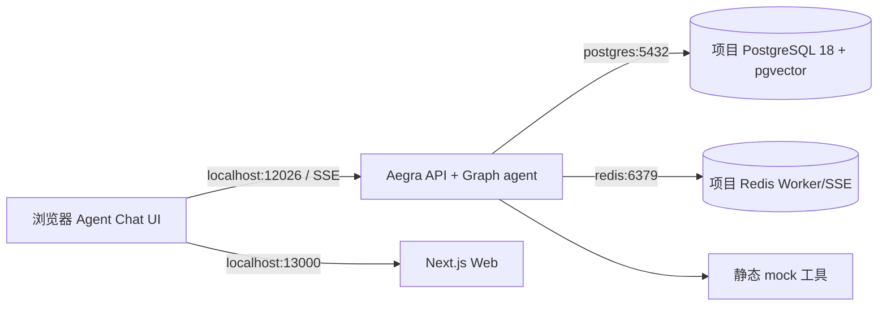

# 架构与数据流

浏览器用公开给本机的回环地址访问 API，容器内服务通过 Compose DNS 通信。`api` 由 `aegra serve` 启动；Thread、Run 和 checkpoint 由 Aegra 写入项目数据库。`REDIS_BROKER_ENABLED=true` 试用 Worker/SSE 模式。Graph 基于 `MessagesState`，`messages` 与 Agent Chat UI 兼容。`status` 分支显式生成 tool call，`ToolNode` 返回 `mock=true`；`/approve-demo` 分支用 LangGraph `interrupt()` 暂停，恢复值必须是 `{"decision":"approve"}` 或拒绝值。两者均无外部副作用。

Graph 后续接入位置：在 `server/src/kube_triage/` 中添加 MCP client 与只读工具，另设权限层将集群凭据隔离；真实修复路径须独立策略、结构化审批、审计和回滚设计，本阶段不提供。
