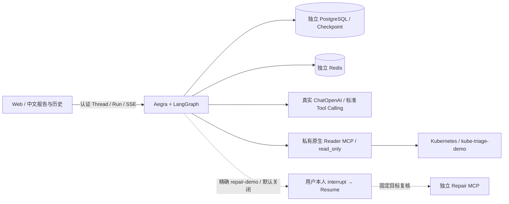

# 当前架构：Real-by-default

可选的 [Issue #78 业务持久化](issue78-demo.md) 在现有 Aegra FastAPI/同一 PostgreSQL 中增加独立 `app_*` 表：Host Reader 回执写 Evidence；服务端通过 Agent Protocol 回读 State、同步用户可见 History；Web 保留 `useStream` 并按消息 ID 合并历史。`APP_HISTORY_ENABLED` / `APP_EVIDENCE_ENABLED` 和 Web 构建开关默认关闭，迁移显式执行。History/Evidence 不参与 Repair 或 Memory 的授权判定，Aegra Checkpointer 不变。

Graph 仅有 `llm`、`tools`、`repair_prepare`、`repair_approval`、`repair_execute`。除精确 `/repair-demo` 外，输入均进入 `llm`，包括旧 `status`、固定英文命令和 `/approve-demo`；不生成确定性 Echo 或模拟审批。标准 `ChatOpenAI.bind_tools` → `AIMessage.tool_calls` → 策略执行 → 同 ID `ToolMessage` → LLM 中文总结。每轮最多 4 次模型决策、6 次工具执行；超预算仍为每个 Tool Call 配对错误消息。

Reader 仅 `pods_list_in_namespace`、`pods_get`、`events_list`、`pods_log`。执行层锁定 Namespace、参数契约、合法 Pod/Container 名、日志 tail 1–100（默认20）、8秒工具调用/发现超时、16KiB结果与无秘密审计。原生 Reader 配置 `read_only=true`，受限 ServiceAccount 承担集群权限边界；Prompt 不能扩大执行权限。工具发现要求恰好四工具，URL 变化会重建客户端及缓存，每次仍验证配置。

正式 Docker CMD 先检查模型与内部 URL、测试环境保护，再启动 Aegra。模型名/Key 缺失、显式 `LLM_ENABLED=false`、非法 Reader URL、正式 `REPAIR_SIMULATED=true` 阻止启动；直接调用 Graph 时同类配置错误使 Run 失败，不变成健康 AI 答案。kubeconfig 缺失的 bind 不自动创建目录；失效凭据/403/401/网络/Schema 差异属于请求期上游错误，不能生成成功工具证据或回退 Mock。`/health` 是 Aegra 服务健康，不能代替实际 Reader/模型可用性验收。

Mock 仅存在独立测试 Compose，其 API 强制 `TRIAGE_ENV=test` 并指向 Mock，Mock 可执行入口也拒绝 production。测试无 kubeconfig 挂载、无 Real Reader/Repair 服务。Fixtures、FakeModel、内存 Checkpoint 和 Mock 协议测试保留；没有第二套正式 Agent。`resources_scale` 从不绑定 LLM。Repair 默认关闭；开启后原有固定 Deployment/UID/副本、proposal_id、审批、执行前复核、未知回执不重试、写后只读回查保持。

旧完整 Thread 消息可只读展示；包含已删除节点的旧 pending Checkpoint 不保证可 Resume，禁止改名映射到 Repair 节点。旧模拟提案与真实执行的 `simulated` 不一致时拒绝，不能把历史模拟批准变成真实写入。升级后新建 Thread；不删数据库或重写历史。
