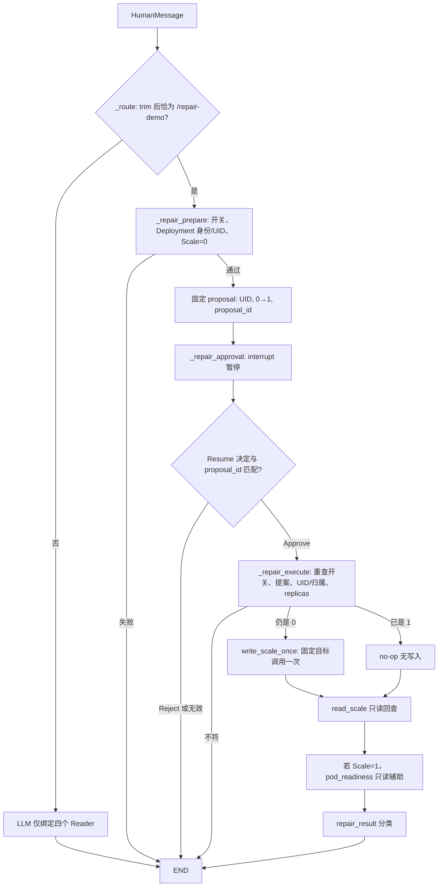

# Issue #15：HITL 真实审批证据包

## 范围、基线与结论

本文件是对已有公开仓库材料的派生梳理，不是新 Run 的原始 Trace。2026-10-15 重新获取的 `origin/main` 为 `f2bfc2f38e49032852cab5f49721619d24847eb5`；[Issue #15](https://github.com/Vc-great/kube-triage-agent/issues/15) 为 Open，[PR #25](https://github.com/Vc-great/kube-triage-agent/pull/25) 已合并。本工作树从该提交建立。历史 [Gate B 原报告](phase3b-gateb-real-e2e.md)记录的是 **2026-10-12**、当时基线 `010d8f4727472cd700c64861d8b834576909e784`，集群为报告中的 Kubernetes 演示环境、Namespace `kube-triage-demo`。这里只保留必要的公开资源名，不公开完整 UID、Thread/Run ID、凭据或内网地址。

**历史结论：真实 Deployment 0→1、用户本人网页 Approve、Pod 最终 Ready；Gate B 仅部分通过，B06=FAIL（流程偏差），Gate B 未运行真实 LLM。** 当时 `LLM_ENABLED=false`；当前 [config.py](../server/src/kube_triage/config.py) 的 `validate_llm()` 已拒绝该配置。历史运行条件不可倒推为当前可直接复现的配置。此次没有连接集群、执行真实 Kubernetes Write、创建审批 Thread/Resume、调用模型或重查当前副本；当前资源状态 **NOT CHECKED**。

### 来源登记与证据等级

| 来源 | 可复查定位 | 时间及等级 | 能证明与边界 |
| --- | --- | --- | --- |
| [Gate B 原报告](phase3b-gateb-real-e2e.md) | “B01–B08 矩阵”“同一 Thread 的实际轨迹”“发现的问题与最小修复”“回归、安全与清理” | 2026-10-12，Real K8s 历史报告 | 记录当时命令、审批、Scale、Ready 和 B06 FAIL；原始私有 State/SSE/日志在此 Worktree **不可直接读取** |
| [Phase 3B 验收](phase3b-validation.md) | “Gate A”“Gate B：真实集群”“已知风险与 CI” | 2026-10-12，Mock Gate A 与 Real Gate B 摘要 | A01–A10 为模拟写入及真实 API/Web/Checkpoint；B01–B08 另列，不能互相替代 |
| [历史 runbook](phase3b-gateb-runbook.md) | B01–B08 步骤 | 2026-10-12，历史操作说明 | 仅作背景，不执行其中的集群、Compose、审批命令 |
| [Graph](../server/src/kube_triage/graph.py) / [Repair](../server/src/kube_triage/repair.py) | `_route`、`_repair_prepare`、`_repair_approval`、`_repair_execute`；`validate_deployment`、`parse_scale`、`write_scale_once`、`pod_readiness` | 当前 `f2bfc2f`，源码实现 | 说明当前代码路径；不是历史运行 Trace，也不能证明集群当前状态 |
| [Reader](../server/src/kube_triage/mcp_client.py) / [Prompt](../server/src/kube_triage/prompts.py) / [Config](../server/src/kube_triage/config.py) | `ALLOWED_TOOLS`、`build_model_tool_schemas`、`validate_call`；`SYSTEM_PROMPT`；`validate_llm` | 当前 `f2bfc2f`，源码实现 | 模型仅有四个只读 Reader 工具；历史 Gate B 的关闭模型配置与当前不同 |
| [Phase 3B 单测](../server/tests/test_phase3b.py) | 两个 YAML 回归测试、审批/重查/丢回执测试 | 当前 `f2bfc2f`，离线模拟/Fake 证据 | 验证特定分支；不证明真实 API Server 的 exactly-once |
| [Gate A 验收脚本](../scripts/acceptance_phase3b.py) / [工具契约测试](../server/tests/test_tool_schema_contract.py) | Mock API/Checkpoint 流程与 Reader schema | 当前源码与历史 Gate A 记录 | 不能当作本次新执行的 Gate A 或 Real K8s 测试 |
| [RBAC](../infra/k8s/repair-rbac.yaml) / [Demo Deployment](../infra/k8s/repair-demo.yaml) / [Compose](../infra/compose.yaml) | 固定资源、权限、历史栈配置 | 当前清单；历史授权另见 Gate B 报告 | 静态定义，不证明当下集群对象存在或权限仍有效 |
| 用户人工确认 | [Gate B 原报告“身份、授权与隔离”](phase3b-gateb-real-e2e.md#身份授权与隔离) | 历史报告转述的用户确认 | 用户本人点击 Approve；不能把 Thread 创建、命令输入改记为用户操作 |
| 未验证 | [Gate B 原报告“回归、安全与清理”](phase3b-gateb-real-e2e.md#回归安全与清理) | 未验证 | 真实写中途进程崩溃、全局 exactly-once、真实 LLM 自动审批修复、当前集群状态均无本轮证据 |

## B01–B08 历史验收矩阵

下表沿用 [Gate B 原报告“B01–B08 矩阵”](phase3b-gateb-real-e2e.md#b01b08-矩阵) 的编号与状态，均为 **2026-10-12 历史结论**，不是本次复测。

| Gate | 历史状态 | 对应证据与边界 |
| --- | --- | --- |
| B01 | PASS | 原报告记录当时 Host/Context/Namespace、节点、标签和对象不存在的只读预检；当前未查询。 |
| B02 | PASS | 原报告记录当次单独授权创建 [RBAC](../infra/k8s/repair-rbac.yaml) 和 [Deployment](../infra/k8s/repair-demo.yaml)，初始 replicas=0、目标 UID 已核对；不是今天状态。 |
| B03 | PASS | 原报告记载 Reader/Repair 受限身份 `auth can-i` 10/10；[Role](../infra/k8s/repair-rbac.yaml) 限定目标和 verbs。未对每种拒绝发真实写请求。 |
| B04 | PASS（修复后） | 原报告记载运行态原生四 Reader、Repair 唯一 `resources_scale`，最初 Scale 零值省略解析失败，修复后只读复测 PASS；当前 [parse_scale](../server/src/kube_triage/repair.py) 和[测试](../server/tests/test_phase3b.py)可核对。 |
| B05 | PASS | 原报告的 Reject Thread 有 SSE/State/Checkpoint/History 和网页对照，拒绝路径 `repair_scale_call=0`、当时真实 Scale 仍为 0；[审批代码](../server/src/kube_triage/graph.py)拒绝后 END。原始私有 Trace 此处不可读。 |
| **B06** | **FAIL（流程偏差）** | **用户本人网页 Approve、当时真实 Scale 0→1；但该 Thread 及 `/repair-demo` 输入由 Codex 完成。** 原报告“同一 Thread 的实际轨迹”仅记录脱敏标识；不得重做或改写。 |
| B07 | PASS（分层验证） | 原报告记录写回执、同 UID Scale/Deployment Desired=1，随后 Deployment Ready=1、Pod Ready=True；写后 Graph 当时 Ready unknown，修复 [pod_readiness](../server/src/kube_triage/repair.py) 后只读回查 ready。不能把后来的结果提前填入当时 Graph。 |
| B08 | PASS（已执行范围） | 原报告记录历史 checkpoint、服务重建后 State/History 持续，以及当时独立 Compose 清理；未演练真实写中途崩溃或真实 LLM。 |

### Gate A 与 Gate B 的层级对照

| 维度 | [Mock Gate A，A01–A10](phase3b-validation.md#gate-a) | [Real Gate B，B01–B08](phase3b-validation.md#gate-b真实集群) |
| --- | --- | --- |
| 执行目标 | `REPAIR_SIMULATED=true`；Mock Repair 仅改变隔离进程内存 | 当时 `REPAIR_SIMULATED=false`；固定真实 `kube-triage-demo/Deployment/triage-repair-demo` 一次受控 0→1 |
| 交互证据 | 真实 Aegra API/SSE、Thread/History/Checkpoint 与网页审批；模拟 Reject/Approve、错 proposal、超时和丢回执等分支 | 用户本人网页 Approve；真实 Scale 与后续只读 Ready 观测；B06 因命令输入主体不符而 FAIL |
| 模型与故障注入 | 当轮 `LLM_ENABLED=false`；离线测试覆盖异常，真实网络/RBAC 故障未全演练 | 当轮 `LLM_ENABLED=false`；没有真实 LLM Run，也没有 LLM Tool Call 驱动 Repair；Mock 故障注入不能移作 Real 事实 |

旧 CI 通过只证明相应提交与测试条件；不能证明今天的集群实时 E2E 或把 Gate A 的 Mock 写入说成 Gate B 真实写入。

## 当前源码中的 HITL 路径

下图描述 `f2bfc2f` 的代码控制流，历史操作主体和结果以原报告为准。精确 `/repair-demo` 是 **HumanMessage** 的服务端路由；普通自然语言才进入 LLM。`_llm()` 的 `bind_tools` 仅绑定 [四个原生 Reader](../server/src/kube_triage/mcp_client.py)，`resources_scale` 不给模型。

| 流程段 | 代码定位 | 准确边界 |
| --- | --- | --- |
| 精确路由、预检、固定提案 | [graph.py `_route()` / `_repair_prepare()`](../server/src/kube_triage/graph.py)；[repair.py `repair_enabled()` / `read_deployment()` / `validate_deployment()` / `read_scale()`](../server/src/kube_triage/repair.py) | 固定 Kind/Namespace/name/UID 与 `replicas=0`；默认 `REPAIR_ENABLED=false` |
| 模型隔离 | [graph.py `_llm()`](../server/src/kube_triage/graph.py)；[mcp_client.py `ALLOWED_TOOLS` / `build_model_tool_schemas()`](../server/src/kube_triage/mcp_client.py) | 只绑定 `events_list`、`pods_get`、`pods_list_in_namespace`、`pods_log`，无 Repair Tool |
| 人类决策 | [graph.py `_repair_approval()` / `_after_repair_approval()`](../server/src/kube_triage/graph.py) | `interrupt()` 暂停；Resume 字典只能含 `decision` 与当前 `proposal_id`；代码校验结构，真人点击是历史报告另证 |
| 执行与分类 | [graph.py `_repair_execute()`](../server/src/kube_triage/graph.py)；[repair.py `write_scale_once()` / `pod_readiness()`](../server/src/kube_triage/repair.py) | 重查后为 1 则 no-op；为 0 才一次函数调用；`repair_result` 保留回执、Observed 和 Pod 状态 |

`_repair_execute()` 的分类并非单一“成功”：回查为 1 且有回执、Pod ready 时是“写操作已成功且可验证”；无重复写入时是“目标已达成（无重复写入）”；Pod unknown/未 ready 各有单独分类。失联或回查失败保留“写结果未知/失败”。执行前重查降低误写风险，**不能消除 GET→UPDATE 并发竞态**；一次 `write_scale_once()` 函数调用不构成 Kubernetes 全局 exactly-once 保证。

## 两个真实 YAML 兼容问题

| 问题 | 原失败、最小修复与证据级别 |
| --- | --- |
| Scale 0 值省略 | 历史 `v0.0.67` 无 `scale` 参数 GET 可返回 `spec: {}`、`status.replicas: 0`；早期仅取 `spec.replicas`，B04 **首次失败**。[当前 `repair.parse_scale()`](../server/src/kube_triage/repair.py)只在 `spec` 为空且 `status.replicas == 0` 时补 0，其余异常格式仍经后续校验拒绝。[`test_parse_real_scale_zero_omitted_from_spec`](../server/tests/test_phase3b.py)为离线回归；[原报告“发现的问题与最小修复”](phase3b-gateb-real-e2e.md#发现的问题与最小修复)记载修后真实只读复测 PASS。 |
| Reader 顶层 YAML sequence | `pods_list_in_namespace` 原生响应可为顶层列表，早期只接受 `items/pods` 包装，写入当时 Graph 报 Pod Ready unknown。[当前 `repair.pod_readiness()`](../server/src/kube_triage/repair.py)用 `yaml.safe_load` 同时接受列表和包装对象；[`test_pod_readiness_accepts_real_mcp_yaml_sequence`](../server/tests/test_phase3b.py)为离线回归。[原报告 B07](phase3b-gateb-real-e2e.md#b01b08-矩阵)记载修后真实 Reader **只读**回查 ready；不改变当时 Graph 的 unknown。 |

## 写回执、期望副本、Ready 与根因

| 字段/观测 | 可支持的结论 | 不可推出 |
| --- | --- | --- |
| `write_attempted` | [Graph](../server/src/kube_triage/graph.py)已进入写尝试分支 | API Server 已提交或成功 |
| `write_response_received` | `write_scale_once()` 返回并经应用解析为目标 1 | 分布式 exactly-once、无外部并发 |
| `spec.replicas` / Scale `spec.replicas` | 期望副本数或写目标 | Deployment/Pod 已 Ready |
| `Deployment.status.readyReplicas` | 控制器在当次读取时统计的 Ready 副本 | 与写回执同步、应用端到端健康 |
| Pod `Ready=True` | 特定 Pod 在当次读取时满足就绪条件 | CrashLoopBackOff/OOMKilled 根因已修复 |
| `observed_replicas` | Graph 写后只读 Scale 回查数值 | 该数值唯一由本次请求造成 |
| 超时或丢失回执 | 写可能已完成，代码停止自动重试并只读回查 | 可以把回查 1 归功于本次写；成功归属应为 UNKNOWN |
| Checkpoint Replay / `interrupt` | 可恢复审批状态并路由后续节点 | 对外部 Kubernetes 副作用有全局 exactly-once |

[测试中的丢回执与 no-op 分支](../server/tests/test_phase3b.py)只支持特定代码路径“不自动重试”“不重复写入”。历史未对真实写中途断电或重放做全面演练。Scale=1 与 Ready=True 均不等于原故障根因修复。

## 权限、留存与真实性声明

[RBAC](../infra/k8s/repair-rbac.yaml)定义独立 Repairer SA，仅对目标 `deployments/scale` 允许 `get/update`、目标 Deployment 允许 `get`；[Repair](../server/src/kube_triage/repair.py)固定 Kind、Namespace、name、目标 1 与 UID/归属校验。[Reader](../server/src/kube_triage/mcp_client.py)只暴露四只读工具，使用另一受限身份。`REPAIR_ENABLED=false` 为默认值。Gate B 的权限证据是当时 `auth can-i` 结果；不声称未记载的真实 deny 写测试。

[Gate B 原报告“回归、安全与清理”](phase3b-gateb-real-e2e.md#回归安全与清理)记载演练结束保留 `triage-repair-demo` Deployment 与 Repairer SA/Role/RoleBinding，其他本轮独立 Compose 与临时工作目录按当时记录处理。历史 Desired/Ready=1 **不是**今天的观测；现况 **NOT CHECKED**。原始私有 State/SSE/审计日志在此 Worktree 不可直接读取，本文件对它们只引用历史报告，不伪造新截图或 Trace；本轮不自动清理任何遗留对象。

## 60–90 秒叙述稿与递进追问

“这次 HITL 演示入口是精确的 `/repair-demo`，服务端先检查固定 Deployment 的归属、UID 和 0 副本，生成只允许 0 到 1 的提案。模型只绑定四个只读 Reader 工具，Repair 的 `resources_scale` 不提供给模型。审批节点用 `interrupt()` 挂起，收到与当前 proposal_id 匹配的人工决定才继续；拒绝就结束，批准后再查 UID 和副本数，已经为 1 就不重复写，为 0 才调用一次 Scale，然后只读回查 Scale 和 Pod Ready。2026 年 10 月 12 日的真实演练中，用户确实亲自点击网页 Approve，Deployment 真实从 0 到 1，Pod 后来 Ready；但 B06 仍是 FAIL，因为 Thread 和命令由 Codex 创建与输入。那次没有真实 LLM Run。写回执、Desired、Ready 和根因是不同证据；回执丢失、Checkpoint 重放及 GET 到 UPDATE 的竞态，使我们不能承诺 Kubernetes 全局 exactly-once，也不能说扩容修好了故障根因。”

1. 若 Resume 的 `proposal_id` 不匹配，或执行前 Deployment UID 改变，代码如何阻断写入？哪些条件只能由历史人工操作记录证明？
2. 如果 API 已更新 Scale 却丢了回执，回查为 1 时为什么仍标 UNKNOWN？Checkpoint 重放时 no-op 的保证边界是什么？
3. Gate A 的 Mock Checkpoint 与 Gate B 的真实 Scale 分别证明了什么？Scale=1、Deployment Ready=1 和 Pod Ready=True 各自还缺什么根因证据？

## 本轮验收矩阵

| Gate | 状态 | 实际依据或缺口 |
| --- | --- | --- |
| H00 | PASS | 实时 `origin/main=f2bfc2f`、Issue/PR 状态核验；独立 Worktree；指定历史报告、源码、清单均确认 |
| H01 | PASS | 上表忠实保留 B01–B08，尤其历史 **B06=FAIL** 与首次解析失败 |
| H02 | PASS | Mermaid 与当前 Graph/Repair 函数逐项对应；LLM/Repair 分离 |
| H03 | PASS | 两个 YAML 问题的原失败、当前修复、离线测试与历史只读回查分级 |
| H04 | PASS | Approval、UID、回执、Desired/Ready、根因与 Replay 分层 |
| H05 | PASS | [无写展示手册](issue15-hitl-readonly-demo.md)只用静态材料；不含集群写命令 |
| H06 | PASS | 2026-10-15：相对文档链接检查 PASS、Mermaid 单图基础结构检查 PASS、`git diff --check` PASS；现有 Python 3.14 虚拟环境 `ruff check src tests` PASS，`test_phase3b.py` 23 passed，全量 pytest Host 重跑 217 passed。首次 sandbox 全量测试 216 passed/1 failed，仅因无法在托管 Worktree 创建忽略目录；Host 同命令通过。未下载依赖；Web/Compose/真实 K8s E2E 均 NOT RUN。 |
| H07 | PASS（Draft PR）；独立 Review BLOCKED | [PR #26](https://github.com/Vc-great/kube-triage-agent/pull/26) 已创建且保持 Draft；本环境只有 PR/CI 状态读取能力，未获得独立 Reviewer 运行通道。最终 HEAD 的 CI 以该 PR Checks 页面为准，不借用 PR #25 的 CI；不自动合并。 |
| H08 | PASS | 本轮真实 K8s Write/Approve/Resume/LLM Run 均为 0；Compose 未启动；当前状态 NOT CHECKED |
