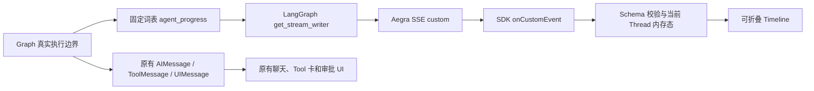

# Issue #37：Agent Execution Timeline 设计

## 数据流与边界

Progress 是后端已发生的确定性状态。它既不是模型的 reasoning summary，也不是 raw chain-of-thought。正文继续走现有 `messages` / `values`，Tool 结果继续由原有 Tool 卡展示。Timeline 不写入 Graph State、Checkpoint、数据库或 Redis，因此刷新后不会重建旧进度；正式历史仍照常恢复。

## 事件协议

`version=1`、`type=agent_progress`、每事件 UUID `event_id`、`stage`、`status`、固定 `label` 是基本字段。Aegra 当前节点配置中可取得的 `thread_id` 才会附带。Context 另有 `context_operation=trim|summary`；Tool 可附 allowlist 内的 `tool_name` 和原 AIMessage 的 `tool_call_id`。ID 至多 128 个 ASCII 字母、数字、下划线或短横线。`tool_call_id` 只用于关联，绝非授权凭证。事件字段和中文 label 在服务端白名单构造，前端再次按相同协议拒绝未知字段、动态文案和越界 ID。服务端每节点最多发 16 条，前端每次 Run 最多保留 64 条；超额丢弃，不影响诊断。

状态来源：`_llm` 的 Gate A 裁剪、Gate B 摘要启动/采用/缓存/回退、模型请求与返回、最终答复；`_execute_tool` 的每个 Reader `call_tool` 前后、失败和预算跳过。Tool `ok=false` 对应 `failed`，不能先报完成。发送失败只记固定安全审计码 `agent_progress_emit_failed`，不会吞掉工具原有异常，也不改变 ToolMessage 状态。长列表默认折叠，运行时标题显示当前已开始的阶段；摘要结果和 Tool Result 不进入 label。

## SDK 与状态取舍

实际安装版本为 Aegra 0.10.8、Python LangGraph 1.2.14、Python langgraph-sdk 0.4.6、前端 `@langchain/langgraph-sdk` 1.12.0。实测 `streamMode: ["values", "custom"]` 在 Aegra 输出 `event: custom`，React `onCustomEvent` 收到同一事件，同时保留 `values`、消息正文与原 UIEvent 分支。前端按当前 Thread 过滤、每次 submit/Resume 清空、按 `event_id` 去重，并把 Progress 放在独立 React 内存态。`UIMessage` 和 `RemoveUIMessage` 仍用原 `uiMessageReducer`。

同一 Thread 内两个并发 Run 的晚到 Custom 事件缺少可靠的服务端 `run_id`，当前只能以 Thread 和最新 `onCreated` 生命周期做有限隔离；断线重放也只能对相同 `event_id` 去重。界面不依据 Progress 推断执行成功，权威仍是正文、ToolMessage、Checkpoint 与审批状态。后续若需要严格跨 Run 恢复，应先确认 Aegra/SDK 在 Custom payload 中提供可靠 Run 关联，不应在客户端造 ID。

## Context Summary 隔离与非目标

内部 `generate_summary()` 调用加 `nostream` 标签，并仅从 AIMessage 的文本块提取 JSON 文本后交由原有 `validate_summary` 严格校验；不接受任意对象或降低 schema/低信任检查。无效摘要继续回退 Gate A。实测合成 21 条消息的摘要成功与 invalid_schema 流中，内部 JSON 未出现在 `messages` SSE，最终正文在 `values` 正常出现。

不增加模型调用、MCP 调用、Graph 节点/边、Reader Namespace、Repair 写路径、审批路径或新的存储。没有模型评论流；不展示 encrypted reasoning、日志、Prompt、异常原文，也不添加未经证实的耗时数字。
