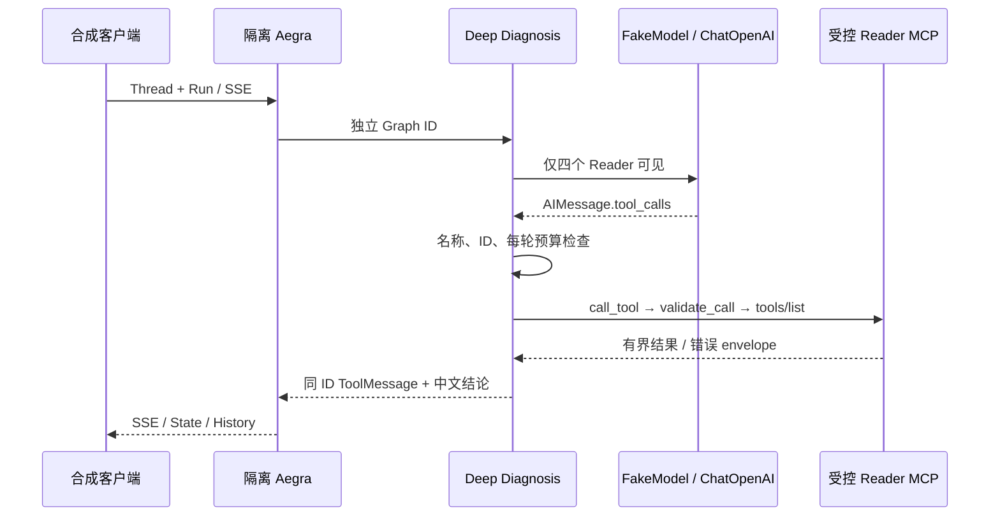

# Issue #41 Phase A：隔离 Deep Agents 兼容性设计

## 基线与入口

原 Phase A 基于 `origin/main` `a6a287352c1af05bc365406ddf4db6b46ee8f07e`。正式 `server/aegra.json` 仍仅注册 `agent`，`graph.py` 未改。实验入口是 `server/aegra.phase-a.json` 的 `deep_diagnosis`；2026-10-18 Closure 将该实验配置收紧为只注册此 Graph，避免 Fake 协议运行装载正式 Provider Client。Web 默认 Graph ID 仍为 `agent`，无新按钮。

原 Graph 的普通诊断为 LLM↔Reader，单轮 4 次模型决策、6 次 Reader 调用；`/repair-demo`、Memory 录入/撤销与 Context Summary 有独立路由。Reader 执行层在 `mcp_client.py` 仅接受四个工具，限制 `kube-triage-demo`、Pod/容器名、`tail=1..100`、额外字段，发现时要求 tools/list 恰好四项。Reader 发现和调用各有 8 秒超时，结果最多 16 KiB。`docs/architecture.md` 的节点图未列新近合并的 Memory/Context 节点，故以源码为准。

## SDK 核验与装配

锁定 `deepagents==0.7.28`；与 `aegra-cli==0.10.8`、`langgraph==1.2.14`、`langchain-openai==1.7.0` 同时安装，未升级原有主版本。查阅 [官方概览](https://docs.langchain.com/oss/python/deepagents/overview)、[定制](https://docs.langchain.com/oss/python/deepagents/customization)、[Profiles](https://docs.langchain.com/oss/python/deepagents/profiles)、[Backends](https://docs.langchain.com/oss/python/deepagents/backends) 与 [0.7.28 Changelog](https://github.com/langchain-ai/deepagents/blob/main/libs/deepagents/CHANGELOG.md)；参考页面 `create_deep_agent` 当时不可访问，函数签名与实施细节直接以已安装 wheel 的 `deepagents/graph.py`、`profiles/harness/harness_profiles.py`、`middleware/_tool_exclusion.py` 核对。

`build_graph()` 真正调用 `create_deep_agent(model=chat_model(), ...)`。Profile 为 `openai` 和测试专用 `protocol_fake` 关闭默认通用 Subagent、移除 `SummarizationMiddleware`，从最终工具表剔除虚拟文件与执行工具。`FilesystemMiddleware` 作为 SDK 必需骨架保留，Backend 为 `StateBackend`，未使用宿主文件、Shell 或 Kubernetes 执行器；不传 Skills、Memory、Todo。0.7.28 的 `_ToolExclusionMiddleware` 同时过滤模型工具与执行请求，但 SDK 注释不将其视为安全边界，因此另加 `ReaderBoundary`：模型请求只传四个 Reader，工具执行前再次拒绝其他名称，按当前 Human 轮次限制 4 次模型决策和 6 次 Reader 调用。并行调用按同一 AIMessage 中的位置计入预算；超限调用仍得到同 ID 错误 ToolMessage。

薄适配用四个 `StructuredTool` 调用现有 `call_tool()`；后者执行 Namespace、参数、tools/list、超时与截断策略。适配层把 `ok=false`、空结果、坏 JSON 和错配 ID 标为错误。正式模型由现有 `chat_model()` 产生，没有硬编码公开模型。测试入口 `DEEP_DIAGNOSIS_FAKE_MODEL=true` 仅在 `TRIAGE_ENV=test` 可用，模型继承 `BaseChatModel`，没有 Provider 客户端。

## 工具与权限矩阵

| 工具/能力 | 来源 | 模型可见 | 调用者与执行前校验 | 作用域/副作用 | 证据 |
| --- | --- | --- | --- | --- | --- |
| `pods_list_in_namespace` | 原生 Reader MCP | 是 | 模型→`ReaderBoundary`→`call_tool()`；tools/list、Namespace、字段白名单 | `kube-triage-demo` 只读 | FakeModel 工具表；现有 Reader 测试 |
| `pods_get` | 原生 Reader MCP | 是 | 同上，另校验 Pod 名 | 指定 Namespace/Pod 只读 | 并行 ID、跨 Namespace 负测 |
| `events_list` | 原生 Reader MCP | 是 | 同上 | 指定 Namespace 只读 | Aegra+Mock MCP SSE/State |
| `pods_log` | 原生 Reader MCP | 是 | 同上，另校验容器与 `tail=1..100` | 指定 Pod 日志只读；最多 16 KiB 送入状态 | 静态代码与现有测试 |
| `task` / Subagent | Harness | 否 | Profile 禁用；执行层按名称拒绝 | 无执行 | 轮次工具清单、未知工具负测 |
| `write_todos` | Harness | 否 | 未装载 Todo；执行层拒绝 | 无执行 | 轮次工具清单 |
| `ls/read_file/glob/grep` | Harness 虚拟 FS | 否 | Profile 排除；执行层拒绝 | `StateBackend` 未暴露文件工具 | 轮次工具清单、SDK 源码 |
| `write_file/edit_file/delete/execute/shell` | Harness | 否 | Profile 排除；执行层拒绝 | 无宿主 FS 或 Shell 执行 | 轮次工具清单、未知工具负测 |
| `resources_scale` | 原 Repair MCP | 否 | 实验 Graph 未引用 Repair | 无 Kubernetes 写操作 | 静态代码；隔离实例 Repair=false |

模型可见性是 FakeChatOpenAI 收到的实际绑定工具列表所证明；真实 Provider 的 Profile 组合和动态工具列表仍未测试，因此不能把本表解释为真实模型已验收。Reader 回执是低信任数据，不能提升成系统指令、修复授权或当前健康结论；FakeModel 不证明真实模型能抵御语义层 Prompt Injection。

## Closure 补强（2026-10-18）

`ReaderBoundary.aafter_model(state, runtime)` 采用锁定 LangChain Middleware 的状态更新契约，返回 `{"messages": [AIMessage(id=原消息 ID, ...)]}` 覆盖本次最终答复，不改写原始 Tool Call/ToolMessage。仅对显式 `Pod <name>` 目标生效（复用 `target_pod()` 并覆盖常见自然问法）；问候与模型介绍可无工具回答。守卫只看本轮配对且唯一的 `pods_get` ID、固定 Namespace/名称、成功状态、Pod kind、UID 和有效 phase；同轮 UID 冲突拒绝确定性结论。403/404/超时只从真实配对错误回执映射为固定文案。此守卫不读取 Memory，不获得 Repair 或写权限。Provider 入口显式设置 `DEEP_DIAGNOSIS_ENABLE_PROVIDER=true` 才可启动；默认关闭。测试 Fake 直接继承 `BaseChatModel`，实现同步、异步和流式接口，并禁止测试进程建立网络连接。

独立审查后在 `abefore_agent` 增加新 Run 输入检查：当前 Human 轮次不得预置 AI/Tool 消息，防止客户端注入伪造 `pods_get` 回执。Pod `status.phase` 先校验为字符串，再检查枚举；异常形状只会变成未核验。实验无人工中断恢复路径；旧轮消息位于新 Human 之前，不作为本轮证据。

## 隔离与回退

正式配置、Web、原 Graph、Memory、Repair、Checkpoint Schema 均无变更。实验需显式选择新配置、独立端口与独立数据库；Aegra 注入原有 Checkpointer/Store，`create_deep_agent()` 未指定 in-memory checkpointer。停用实验只需不用 `aegra.phase-a.json`。本期没有 Planning、Todo UI、Context Offloading、Skills、Subagent 或真实模型评测。
