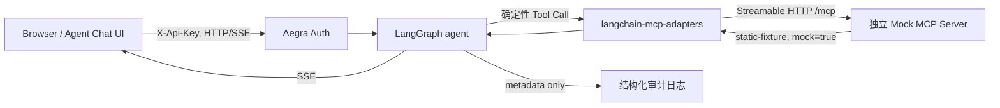

# Phase 1A 设计：真实协议，静态数据

本阶段仍是单用户、本机 Demo。浏览器输入项目 `.env` 中的随机 `DEMO_API_TOKEN`；Aegra 0.10.8 的 `auth.path` 调用 `auth.authenticate()` 验证 `X-Api-Key`，成功后身份固定为 `demo-user`。Key 错误直接拒绝，不创建 guest。采用 Aegra 原生入口是因为它已经覆盖 Thread、Run、History、SSE、Resume 等 Agent Protocol 路由；单独在前端放登录按钮无法保护直接访问 API 的客户端。

| 位置 | 输入 → 输出 | 为什么需要 / 失败行为 |
|---|---|---|
| `auth.py:authenticate` | Header → 固定 identity 或拒绝 | 保护业务 API；缺失环境变量启动报错，错 Key 返回 401 |
| `graph.py:parse_demo_command` | `pods/events/logs` 文本 → 三种固定 Tool Call | 可复现且无 LLM Key；语法错转为拒绝结果，不执行任意工具 |
| `mcp_client.py:call_tool` | Tool 名与参数 → MCP 返回或用户可读错误 | 只接受白名单、`demo`、有界参数；每次调用 8 秒超时并记元数据日志 |
| `mock_mcp.py` | MCP 请求 → 静态 Pod/Event/Log | 独立容器证明协议调用；服务端再校验 Namespace、Pod 与日志行数 |

实测匿名例外：`GET /health`、`/info`、`/docs`、`/openapi.json` 返回 200；`POST /assistants/search` 和 `/threads` 返回 401。`/info` 是公开元信息，因此 Web 用受保护的 Assistant 查询检查 Key。

`MultiServerMCPClient.get_tools()` 在首次实际查询时发现工具，进程内缓存转换后的 LangChain Tool；adapter 调用时建立 MCP 会话。Graph 的 `tools` 节点直接调用 adapter Tool，未使用 LLM 或 `ToolNode`；这里的工具选择是确定性规则，不能说成自主规划。Server 数据有正常 Pod 和 `CrashLoopBackOff` Pod，均带 `mock: true` 与 `source: static-fixture`。

审计只记 thread、工具、允许/拒绝的 Namespace、耗时、结果及错误类别，不记 Key、Header 或日志正文。MCP 不可用、超时和服务端工具异常返回不同类别的简明信息；不会无限重试。Compose 私有网络内才可访问 MCP/PostgreSQL/Redis，宿主机仅 Web/API 绑定 `127.0.0.1`。浏览器 Key 存在 localStorage，存在本机脚本读取风险；只供个人机器或可信 SSH Tunnel 使用。

Phase 1B 才考虑实验 Namespace 的只读 Kubernetes MCP、真实身份/权限以及 LLM 工具选择。生产环境可选 OAuth/OIDC、TLS、独立审计存储与更严格的网络策略；本轮均未实现。

接口依据：[Aegra 0.10.8 认证文档](https://github.com/aegra/aegra/blob/v0.10.8/docs/guides/authentication.mdx)、[Aegra 配置参考](https://github.com/aegra/aegra/blob/v0.10.8/docs/reference/configuration.mdx)、[MCP Python SDK](https://github.com/modelcontextprotocol/python-sdk)、[LangChain MCP Adapter](https://github.com/langchain-ai/langchain-mcp-adapters)。
