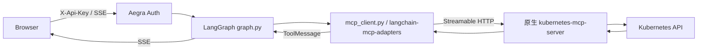

# Phase 1B 设计：原生 Kubernetes MCP 只读接入

## 为什么做

Phase 1A 已证明 Aegra 鉴权、Thread/Run/SSE、LangGraph 确定性调用和跨容器 Mock MCP。Phase 1B 将同一调用链指向 Kubernetes API，检验受限身份是否可读真实 Pod、Event 与日志。仍不接 LLM、不诊断推理、不自动修复；`/approve-demo` 仍是模拟审批。

## 为什么没有业务 Adapter

只有一个固定上游 Server、一个实验 Namespace 和四个查询，不存在需要统一的多厂商模型。`graph.py:parse_demo_command()` 直接给出上游工具名和参数，`mcp_client.py:validate_call()` 只校验调用边界，`call_tool()` 通过通用 `langchain-mcp-adapters` 转换协议。`_summarize()` 显示原生文本；没有 Pod/Event/Log DTO 或额外 API 层。

| 用户命令 | 原生工具 | 实际传参 |
| --- | --- | --- |
| `pods kube-triage-demo` | `pods_list_in_namespace` | `{"namespace":"kube-triage-demo"}` |
| `pod kube-triage-demo <name>` | `pods_get` | `{"namespace":"kube-triage-demo","name":"<name>"}` |
| `events kube-triage-demo` | `events_list` | `{"namespace":"kube-triage-demo"}` |
| `logs kube-triage-demo <name>` | `pods_log` | `{"namespace":"kube-triage-demo","name":"<name>","tail":20}` |

依据上游 [v0.0.67 README](https://github.com/containers/kubernetes-mcp-server/blob/v0.0.67/README.md) 与 [同版本配置参考](https://github.com/containers/kubernetes-mcp-server/blob/v0.0.67/docs/configuration.md)。已用固定镜像和无真实凭据的临时 kubeconfig 运行 `tools/list`：恰好四项；`pods_list_in_namespace.namespace`、`pods_get.name`、`pods_log.name` 必填，`events_list.namespace`、`pods_get.namespace`、`pods_log.namespace` 在上游 Schema 可选，但本项目始终显式传入。上游 `pods_log.tail` 允许 0（表示不限行），本项目限定 1～100。

## Mock/Real 与边界

`infra/compose.yaml` 默认 `MCP_SERVER_URL=http://mock-mcp:8000/mcp`，不需要集群；设置为 `http://k8s-mcp:8080/mcp` 并启用 `real` profile 才启动固定 v0.0.67 镜像。两种 Server 暴露相同四个工具。Real 配置 `enabled_tools` 仅这四项，`read_only=true`，`toolsets=["core"]`，拒绝 Secret；项目私有 kubeconfig 只读挂载，MCP 没有宿主机端口。当前 Compose 仍启动 Mock 依赖容器，但 API 只连接配置 URL。

三层边界：

1. `mcp_client.py:validate_call()` 限工具名、Namespace、Pod 名、`tail` 和额外参数；调用结果只让最多 16Ki 字符进入 ToolMessage/Checkpoint/UI。审计只记元数据与错误类别。
2. MCP Server 配置限制工具集合和只读操作；这不替代 Namespace 权限。
3. `infra/k8s/reader.yaml` 的 Namespace Role 仅授予 `pods/events get,list` 和 `pods/log get`；ServiceAccount 的短期 Token 才是 API 身份。它没有集群级绑定、Secret 或写权限。

`MultiServerMCPClient(handle_tool_errors=False)` 使 SDK `CallToolResult(isError=True)` 抛出 `_MCPToolExecutionError`，Graph 将其标为失败；连接、超时、403、401、404 分别显示合理消息。Adapter 源码的 [错误转换逻辑](https://github.com/langchain-ai/langchain-mcp-adapters) 与本仓库锁定版本 0.3.2 一致。Token、日志正文和 Header 不进入自定义审计。
