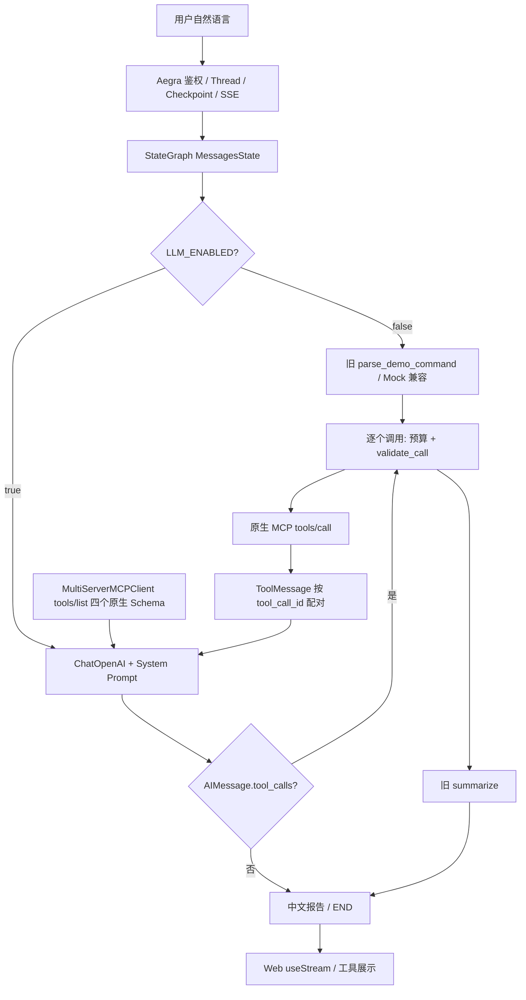

# Phase 2 设计：单 Graph 的只读工具调用

## 现有链路与文件职责

Phase 1B 的 `graph.py` 用 `_route` 识别 `parse_demo_command()` 的四种固定命令；`_request_tool` 伪造一条带 Tool Call 的 AIMessage；`_execute_tool` 调用 MCP，`_summarize` 原样展示结果。`_approval` 只演示 interrupt/resume。旧 `_execute_tool` 只取 `tool_calls[0]`，多调用时丢失其余调用。Phase 2 保留默认确定性路径，LLM 模式进入 `_llm → _after_llm → _execute_tool → _llm`，逐一配对 ToolMessage。

`mcp_client.py` 的 `_allowed_tools` 通过 `MultiServerMCPClient` 发现工具并要求恰好四个原生名称；`validate_call` 限白名单、Namespace、Pod 名、tail 和参数集合；`call_tool` 有每次 8 秒超时、16 Ki 字符截断、脱敏审计及错误分类。`mock_mcp.py` 提供同名四个静态工具。`aegra.json` 保持 `graph_id=agent` 和自定义鉴权，故 Thread/Run/SSE/Checkpoint 接口不变；仅额外允许隔离测试端口 `13001` 的本机 CORS 来源。

`infra/compose.yaml` 仅给 API 容器注入模型变量；Postgres/Redis/MCP 在项目私网，Web 只有 Aegra API 地址。`infra/k8s-mcp/config.toml` 固定 `read_only=true`、四个 `enabled_tools` 且拒绝 Secret；`infra/k8s/reader.yaml` 是 `kube-triage-demo` 中仅 Pod/Event/Log 读权限的 Role/RoleBinding。`phase1b-real-e2e.md` 记录真实 MCP/TLS/RBAC/SSE 证据；`phase1b-ssh-guide.md` 记录稳定运行目录与受控操作。`server/tests/test_phase1a.py` 检查旧路由、MCP 参数、安全边界和认证；`scripts/acceptance.py` 通过 Aegra API 检查 Mock、SSE、审批与持久化。Web `Stream.tsx` 的 `useStream` 获取消息/线程历史，`messages/ai.tsx` 与 `messages/tool-calls.tsx` 展示 AIMessage.tool_calls 及 ToolMessage 结果，无需新渲染层。

## 数据流

`bind_tools` 仅将发现的 Schema 提供给模型，真正执行必须经过 `call_tool`；模型输出不构成授权。Prompt 把 Pod/Events/Logs 视为不可信数据；执行层白名单及固定 Namespace、MCP 只读配置、Kubernetes RBAC 共同限权。每轮用户消息最多 4 次模型决策、6 次工具执行；超额的 AI Tool Call 仍生成同 ID 错误 ToolMessage。计数从最近 HumanMessage 开始，第二问重置。Graph 默认递归上限 25 足以覆盖 4 轮循环并阻止意外无限迭代。

这里使用一个 Agent 循环而非多 Agent、Planner 或 Kubernetes Adapter：面试 Demo 的核心是观察模型选择原生工具、反馈与证据质量；增加这些层会掩盖真实行为。模型供应商若不支持标准 Tool Calling，实际响应可能没有 `tool_calls`，不能算 Agent 工具调用 PASS。
