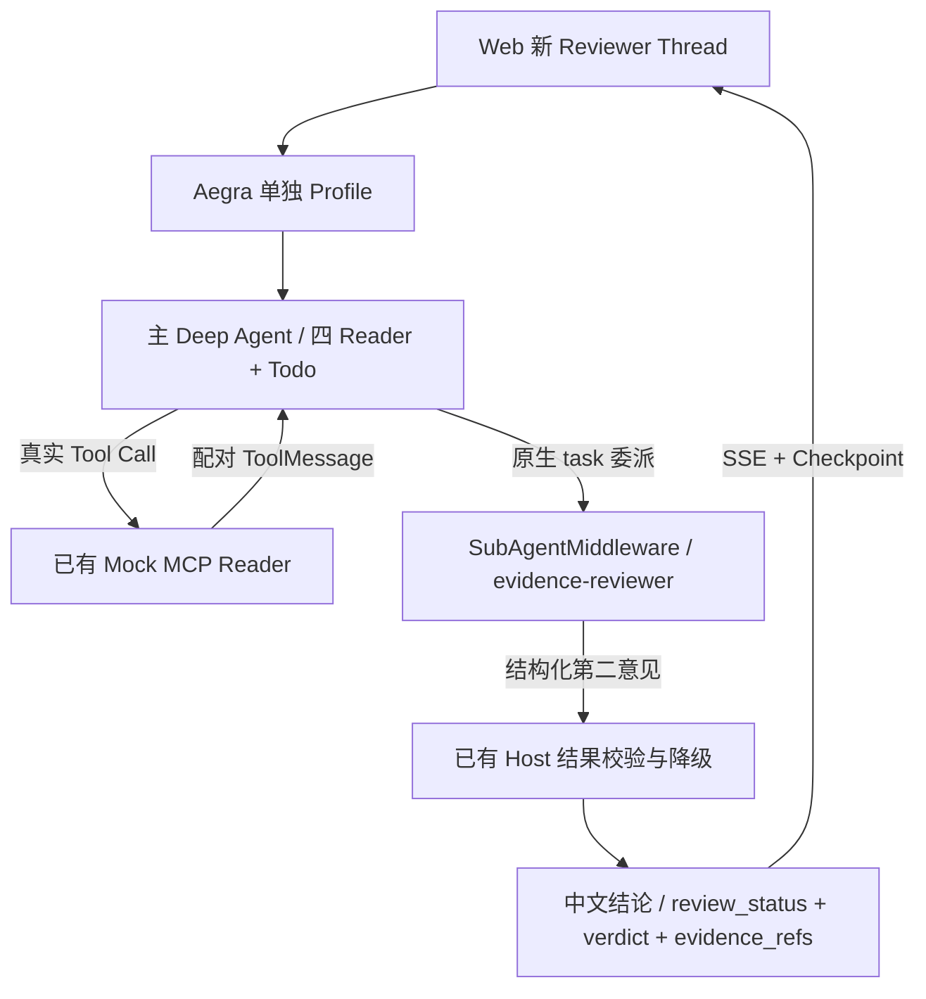

# Issue #72 — Evidence Reviewer Subagent：Demo-first V2 可运行 Web 集成

> - Issue：[#72](https://github.com/Vc-great/kube-triage-agent/issues/72)；仓库 `Vc-great/kube-triage-agent`。
> - 状态：**Proposed / 仅规划**。本版仅经本 Planning PR 审阅并合入 `main` 后生效；**尚无 V2 实施或任何 V2 Gate PASS**。
> - 规划基线：2026-10-23，`main=bea40f31964eb68125c827197f772c6018923f88`（[#85](https://github.com/Vc-great/kube-triage-agent/pull/85) 已合并）；实施前重新 fetch，不锁死 SHA。
> - 已有：[Planning #73](https://github.com/Vc-great/kube-triage-agent/pull/73)、[S1 Implementation #74](https://github.com/Vc-great/kube-triage-agent/pull/74) 已合并；`docs/issue72-evidence-reviewer-s1.md` 是历史 S1 真实证据。
> - **唯一当前权威验收：本文 `6 V2-R0～V2-R7**。原 #73 设计中的 R0–R9 及其 STOP/FAIL 仍作为历史计划/证据留存于 Git 历史、#74 与 S1 报告，**不删除、篡改或宣称已通过**。
> - 设计变更：按用户 2026-10-23 决策，优先功能演示、复用已交付 S1、后置真实模型/人工 E2E；不建设生产级安全/跨进程恢复体系。
> - 当前批准：**设计与纯文档 Planning PR**。代码 Worker 只在本 PR 合并后实施；实施只使用隔离合成 Mock / FakeModel。
> - 与 #69/#41：功能边界独立；**不以前者 Filesystem Offloading/原生 Summary STOP 修复作为先决条件**；Reviewer 本身不使用文件工具。

## 1. 背景、实际代码与需要交付的用户体验

### 1.1 已实现，必须复用

- `server/src/kube_triage/deep_diagnosis_review.py`：已有锁定 `deepagents==0.7.28` 的原生 `create_deep_agent` / `SubAgentMiddleware`，父模型工具为四 Reader + `write_todos` + `task`；唯一子代理 `evidence-reviewer` 的模型**无执行工具**。`ReviewBoundary` 限制一次 task、结果 schema/引用检查、异常降级和中文 Host 结论模板。
- 同模块 `_ReviewGraph(Runnable)` 为 S1 离线 `ainvoke/astream/astream_events` 提供私有执行作用域；`_EXECUTION` nonce、`evidence_manifest` 与 HMAC 签记只认证当前进程当前轮回执。**这一包装器尚未作为 Aegra Graph 进行 HTTP/SSE/持久 Checkpoint 实测**。
- [PR #74](https://github.com/Vc-great/kube-triage-agent/pull/74) 真实 S1：工具白名单、当前轮证明、重放/异常/取消清理专项已修复，CI 通过；R5–R8 的 Aegra/Web/效果评测 **NOT RUN**。`docs/issue72-evidence-reviewer-s1.md` 中初次 R3/R5 的 FAIL/STOP 仍属历史证据。
- `server/src/kube_triage/deep_diagnosis_planning.py` 与 `deep_diagnosis.py` 提供原生四 Reader、Todo、目标 Pod/UID 处理、预算与工具结果；`mcp_client.py` 的 Namespace/参数/8s/16KiB 不变量保持。
- [PR #81/#85](https://github.com/Vc-great/kube-triage-agent/pull/85) 已提供可选 `app_storage.reader_context`、业务 Evidence/History API 和 PG 实验 Profile 复用方式；**不新增第二套证据表、History API 或 UI Hook**。本期不要求必须启用业务持久化才能完成 Reviewer 演示。
- `server/aegra.phase-b1.json` / `aegra.phase-skills.json`、`scripts/skills_demo.py` 及现有 Web `useStream` / Tool Timeline 已支持独立 Profile + FakeModel + Mock MCP；可按需复用启停与进程归属方式。

### 1.2 仍缺少什么

**用户当前不能通过网页打开 `deep_diagnosis_review` 实验 Graph**：没有独立的 `deep_diagnosis_review_entry.py`、Aegra Profile、两级 FakeModel 的 HTTP/SSE 测试及可启动 Web Demo。现有 S1 代码的 `build_graph(model, reviewer_model)` 必须显式传模型，不能直接把 S1 文件当启动入口。

现有 `aafter_model` 会替换末尾回答为保守 Host 模板；已能区分 `review_status`、`verdict`、引用，但展示的具体 Pod 观察比较笼统。本期允许**小幅改善可见诊断内容**，严格基于本轮有效 Mock Reader 的可核对字段，不把 Reviewer 的推测变成事实。

## 2. 本次目标、排除项和不变量

### In Scope：最短可运行 Demo

1. **新建隔离 Reviewer Graph/Profile** `deep_diagnosis_review`，固定 `TRIAGE_ENV=test`、显式 FakeModel/Mock MCP，不改变正式 `agent`、B1/Skills Graph；一条命令或复用既有 Demo 启动机制打开 Web。
2. 完成至少四类浏览器/HTTP 可复现行为：
   - CrashLoop / ImagePull 等**有有效证据**：主 Agent 调用 Reader，创建候选，经原生 `task(evidence-reviewer)` 委派，子代理输出结构化咨询结论；UI 显示 task Tool Call/Result 和最终 `review_status/verdict/evidence_refs`。
   - **证据不足 / 403 / 超时**：没有有效材料则 `SKIPPED/UNREVIEWED/UNKNOWN` 或 `INSUFFICIENT`，根据实际语义区分，不给出“已证实根因”。
   - **普通问候**：不触发 Reader/task，返回简短答复并标记 `SKIPPED`。
   - **同 Thread 后续一轮、刷新与切换新 Thread**：已有用户消息和最终结论可见，不混淆上一轮 Reviewer 意见。
3. 优先复用 `_ReviewGraph`、`ReviewBoundary`、`evidence_manifest`、`validate_review`、`_reader_tools`，只做 Aegra 所必需的适配；不重新编写“审查框架”。原生 `SubAgentMiddleware` 与 `task` 必须实际参与调用，不能用同名 Mock `@tool` 冒充。
4. UI 使用**现有 Tool Timeline** 显示 `task` 和结果；如原生消息已经可读，只增加最小中文 label/状态，不新建复杂 Reviewer Dashboard。最终主 Agent 答案划分“观察、推断、未知、复核状态与引用”。
5. 独立 Aegra HTTP/SSE + Checkpoint/Thread **普通完成轮次**的集成测试、开关/回退、基本耗时与工具次数统计、单一实施 PR/CI/中文复现说明。真人浏览器按项目 [统一 QA #86](https://github.com/Vc-great/kube-triage-agent/issues/86) 后续执行；AO 浏览器自动验收可以作为本次工程证据，但不能等价真人 PASS。

### Out of Scope

- **不做**旧 Reviewer 签记跨进程认证/持久 nonce、精确一次计费、复杂 Checkpoint 恢复证明、Time Travel、客户端任意 `update_state` 输入的专项封闭、攻击专项或多租户服务。本期仅承诺**新建实验 Thread + 正常完成 Run 后的历史/刷新**；旧中断中途 `task` Resume 视为不支持/NOT RUN，不把旧签记变成可信。
- 不开发第二套 Reader/RAG、业务 Evidence Writer、新数据库表、独立 FastAPI、CLI 产品、任务队列、自动化任务调度、专门 Reviewer 管理界面。
- 不做真实模型质量提升承诺、ON/OFF 大批量付费 A/B；FakeModel 的对照只检验功能协议，效果结论留到 #86。
- 不将 #41 `files` State 写入旁路、#69 FS Offloading 或 #13 既有 G03 问题作为本 Demo 新增重构项目；**历史缺陷未修复**必须如实保留。
- 不部署真实 K8s 写入/Repair，不触碰现有稳定 Compose/容器/卷/真实私密日志。

### 不可放松的既有控制

四个原生 Kubernetes Reader + 固定 `kube-triage-demo` Namespace、参数与 UID/Tool Call ID 校验、8s/16KiB、预算、Repair/HITL 用户批准、独立 Checkpointer/Memory 兼容保持原状。Reviewer 仍**无执行工具**，其输出不能授权 Kubernetes 操作；即使是 Demo，也不开放 Shell、Host FS、Repair、任意其他工具。Synthetic Mock 的签记只对**当前执行**有意义，不能因为业务表出现 `evidence_id` 就信任历史资料。

## 3. 推荐技术方案与最小实施边界

### 3.1 数据流

Reviewer 不调用 Reader，不持有真实集群访问权限；当前实际 Reader 回执由 Host 组织成简短 `manifest`，子代理不能自己宣称证据来源。`task` 返回的 `ToolMessage.status` 是执行协议状态，`review_status` 与 `verdict` 是业务评价，三者不能合并为一个 `success`。

### 3.2 **先验证 Aegra Graph 加载**（实施强制首步）

- 在独立 Mock/Aegra 进程下先验证 `_ReviewGraph(Runnable)` 是否能被当前 Aegra 0.10.8 加载并提供 `/assistants`、`/threads`、`/runs/stream`、`/state` 和 `astream`；测试当前线程内 Tool Call/ToolMessage ID、`_EXECUTION` 生存期和工具结果。
- 如果包装器可直接使用：**原样复用**现有 S1 验证逻辑，最小增加 `deep_diagnosis_review_entry.py` 与测试 FakeModel。`build_graph` 当前必须传入主/子模型；新 Entry 从测试专用配置实例化两者，禁止默认真实 Provider。
- 如果 Aegra 对自定义 Runnable 或 graph schema 有真实兼容问题：只对**新隔离 Reviewer Profile**采用公开 SDK 接口的最小适配，允许用 Aegra 支持的编译 Graph 包装/入口；必须仍实际执行原生 `task`、只读 Reader、子代理零工具，且新执行只能使用当前轮有效回执。不能悄悄关闭校验后宣称旧 S1 安全 Gate PASS。
- 若无法让它跑通 Aegra，**停止并记录真实失败请求/错误**；不得转为仅 CLI 成果、额外搭第二 Agent Server，或凭 MemorySaver 的离线测试冒充 Web 集成。
- 不允许为了通过 Aegra 恢复客户端传入的旧 nonce/签记；如无法验证旧 Resume，明确不支持该入口并从**新 Thread**演示。

### 3.3 双 FakeModel 与可观察的报告

- 增加测试专用 `ReviewProtocolFakeModel` / `ReviewerProtocolFakeModel`（名称以仓库风格为准），**两级模型均由 FakeModel 注入**。固定合成案例显式分别产生主模型的 Reader Tool Call、唯一 `task` 与子模型的符合 Schema 的 JSON，结束时 Host 输出最终报告。禁止在 FakeModel 里直接伪造 `task` 的“成功 ToolMessage”；必须跑原生 Middleware。
- 至少覆盖：有效 CrashLoop、有效 ImagePull 或 OOM、缺证据、403/timeout、问候；额外一例 Reviewer 给出 `CONTRADICTS` / `INSUFFICIENT`，与 `SUPPORTS` 在最终展示上可区分。数据集复用已有合成 Pod/UID，缺失指标时保持 UNKNOWN。
- **具体展示建议**：Host 根据本轮有效 Pod Detail 提取少量可核实信息（Namespace、Pod 名、UID、waiting reason、restart count、可见日志/事件的引用 ID），并在固定模板内展示；如果无法解析则只写“收到 N 份 Reader 回执，不能确定根因”。不在 Final 中直接复制子模型未经验证的自然语言句子；只显示 schema 审核通过的 `verdict/references` 和必要的不确定项。
- 调用顺序：普通问候无需强制委派；单轮最多一次 task；有证据但 Reviewer 不返回有效结果时主 Agent 降级并完成本轮，**不能把失败归因成已审查通过**。
- 已有 `MAX_DECISIONS=12`、`MAX_REVIEW_DECISIONS=2`、`TASK_TIMEOUT=20s`、Reader/Todo 预算优先原样沿用。仅当真实 HTTP 时间限制要求调整，提供前后日志说明，不添加无限重试。
- Web 复用 `apps/web` 的 Tool/Timeline 和 `NEXT_PUBLIC_ASSISTANT_ID`；最小增加“Reviewer Demo”明确标签、当前图 ID 与 status 文案。如无必要，不创建自定义 Review Panel。SSE 仅展示可公开的工具事件与第二意见，禁止显示私有推理。

### 3.4 Checkpoint、History、Evidence Store 与停启

- **新建 Thread、完成 Run 后刷新**是本期最低保障；原生 Checkpointer 不替换。`run_id` 仅在实际可获知时归档，否则 NULL，不从文本猜测。上一轮 verdict 只属于上一轮，不在新一轮自动冒充审查结果。
- 如果挂载 `app_routes.py:app`：复用 [#78](https://github.com/Vc-great/kube-triage-agent/issues/78) 已有 HTTP auth、History/Evidence API 与 `reader_context`，仅在用户显式启动持久化 Mock Demo 时启用开关；**不要求 Reviewer 从旧 `app_evidence` 表重做可信来源校验**。若业务路由非必要，允许先保留 Aegra 原生 Thread 历史并复用已有 Profile 基础设施。
- 重新进入旧已完成 Thread 时，**只展示历史 Reviewer 状态**；不得重新对旧签记判断为新执行认证、不得自动执行重复 `task`。
- 取消、超时、断流及 DB 故障：已有执行/流的失败应可见；不声称旧 Reviewer 已得到有效第二意见，不复制旧签记。测试仅要求不会绕过只读工具和“失败非成功”，不将复杂跨进程恢复与恰好一次计费作为本期准入。
- 本次只操作独立 PG/Redis/Mock 测试资源；不删数据卷、不修改正式生产配置。回退只需停止新 Profile/关闭 Demo 入口，原 `agent`、B1 和 Skills 保持正常。

### 3.5 取舍

| 方案 | 价值 | 代价 | 结论 |
| --- | --- | --- | --- |
| **A. S1 原生 Reviewer + 独立 Aegra / Web** | 最大复用；真正双 Agent Tool Timeline；容易与 B1 对照 | 必须先证明 S1 Runnable 与 Aegra 兼容 | **主选** |
| B. 完全新写 LangGraph `review` Node | Aegra 兼容更好控制 | 放弃原生 SubAgent SDK 学习价值，重复实现 | 不选 |
| C. 把 Reviewer 加进正式 `agent` | 演示步骤少 | 干扰已有正式 Reader/Memory/HITL 和成本 | 不选 |
| D. 先做旧签记跨进程认证、State 安全封闭 | 完整性强 | Demo 成本巨大，重复 #41 长期 STOP 专项 | 本期不做 |

## 4. 风险与 STOP

- **首要技术风险**：Aegra 0.10.8 无法接受 S1 `Runnable` 图包装器或 ContextVar 不穿透子任务；这只能通过真实 HTTP/SSE 诊断。优先最小 adapter，若会迫使增加第二服务或停用 SDK 原生 task，则 STOP。
- 子代理工具意外不为零、Reader 白名单/Namespace/参数不再生效、出现 Shell/Host FS/Repair 或真实 Kubernetes 写路径、正式 Graph/Memory/HITL/Checkpoint 回归：**立即 STOP**。
- 历史或客户端伪造的 `ToolMessage` 被显示为本轮“已可信验证”时不能判 PASS。可选择仅新 Thread + Mock 路径，并输出 UNKNOWN；不允许为了展示好看提升证据可信度。
- “Reviewer 证实根因”属展示误导：`SUPPORTS` 是对**当前有界材料与候选一致性**的意见，不是集群事实保证或授权。
- 流式 UI 的 `task` 控件不可见、Run 根本没有子模型调用、无法完成新的普通多轮，属于核心 Demo FAIL。独立 Browser 工具故障可记 UNKNOWN 并给明确手工步骤，不假报 PASS。
- 真实 Provider、真实敏感信息或 Kubernetes 修改、稳定部署改动均需另外授权；当前仅允许 FakeModel+合成 Mock。

## 5. 执行阶段：单个 Implementation PR

| 阶段 | 内容 | 必须交付 |
| --- | --- | --- |
| **V2-A — Aegra SDK Spike** | 最新 main 和现有 S1 基线；独立 Aegra HTTP 验证 Wrapper/Graph/执行作用域，确定最小接入方式 | 真实 HTTP、SSE、受控 Tool ID 结果；V2-R0/R1 的证据 |
| **V2-B — 可运行后端** | 独立 Graph Entry/Profile，双 FakeModel，原生 task + 受限 Reader，错误降级与最终展示改进 | 目标/问候/失败场景的可重放 HTTP 测试；V2-R2/R3 |
| **V2-C — Web / 回归** | 独立启动、Tool Timeline、Thread/刷新、可选业务 History；正式/B1/Skills 回归与演示 | 浏览器自动化、真实 HTTP/SSE/Checkpoint，Mock/PG 证据；V2-R4/R5/R6 |
| **V2-D — 工程收口** | 小型 OFF/ON 合成协议对照、CI、设计偏差和运行手册、独立 Review | 一个代码 PR `Refs #72`，中文 Gate 报告；V2-R7 |

不再强制为功能每一阶段拆独立 PR。V2-A 如果出现真实 SDK 兼容阻断，需要停下描述具体证据和最小替代，而不是无限打补丁或转开发 CLI。Phase 2 之后不得自动进入 #69/#41。

## 6. V2 唯一权威 Gate

| Gate | 测试环境 | 可判 PASS 的具体条件 |
| --- | --- | --- |
| **V2-R0 基线/去重** | GitHub 最新 main、锁定依赖、独立 Worktree | 核实 #74 已合并，#69 未交付 Offloading Graph，现有 Reader/Review/History 能复用；实现仅含新增 Reviewer 演示与必要修复 |
| **V2-R1 真实 Aegra 加载** | 独立 API+PG，原生 SDK | 新 `deep_diagnosis_review` 可经 `/assistants` 创建 Run，`/runs/stream` 真正结束；`_ReviewGraph` 或小 adapter 可正确形成每次运行的作用域；不能用纯 MemorySaver 假代 |
| **V2-R2 原生委派闭环** | FakeModel 主/子两级 + Mock MCP | 四 Reader 执行路径不变，唯一原生 `task(evidence-reviewer)`，子模型确实被调用且工具集为空；Task/Reader ID 和回执一一配对；无第二套伪装 @tool |
| **V2-R3 正向/错误展示** | CrashLoop、ImagePull/OOM、403/timeout、问候、Reviewer 矛盾/失败合成案例 | 最终“观察/推断/未知 + review_status/verdict/引用”可检查；问候无 task；无效/错误/超时不返回伪审查成功；旧签记不提升可信 |
| **V2-R4 Web/Thread** | 真 Aegra SSE + 浏览器自动化 | 页面能看到 Reader、Todo（如触发）、`task` 与最终状态；新 Thread、同 Thread 两轮、刷新、侧栏重进，不串上一轮第二意见。真人测试留 #86，未执行标 NOT RUN |
| **V2-R5 兼容/回退** | 既有正式/B1/Skills 回归；独立 Mock/PG | Reader Namespace/16KiB/预算、正式 Memory/HITL/Repair 不变；Reviewer 图可停止并退回旧 Graph；旧未支持中途 Resume 如实标 NOT RUN、不当成功 |
| **V2-R6 小型协议对照** | ≥6 固定合成 Case；Reviewer OFF/ON | 记录实际 task 次数、工具回执配对、未知/错误处理、端到端时长；不以 FakeModel 证明模型质量提高，未测真实 Token/质量标 UNKNOWN/NOT RUN |
| **V2-R7 交付质量** | 锁定 Python/Web 环境与 CI/Review | Ruff、pytest、协议测试、Web lint/build（涉及时）、`git diff --check`、CI 通过；中文 Demo 步骤、逐 Gate 真实结果、独立 Review、Implementation PR `Refs #72`，未经批准不自动合并/关闭 Issue |

Gate 状态只使用 **PASS / FAIL / NOT RUN / BLOCKED / UNKNOWN**。真实模型、真实 Kubernetes、真人操作不在本期时无需触发，但仍必须显示其 `NOT RUN`。历史 #74 的 S1 离线通过不等于本期 Aegra/Web 自动通过，也不得删掉历史 R3/R5 FAIL/STOP。

## 7. 建议文件与执行纪律

预计最少修改：

- 后端：`server/src/kube_triage/deep_diagnosis_review.py`（如需适配）、新增 `deep_diagnosis_review_entry.py` / `deep_diagnosis_review_fake.py`；`server/aegra.phase-review.json`。
- 独立启动：优先复用 `scripts/skills_demo.py` 的资源管理思路和共用工具，提供 `make dev-deep-review-demo` 或一个轻量脚本；**不生成 CLI 产品**。
- Web：优先沿用 `useStream` / 现有 Timeline，可在 `deep-demo-controls.tsx` 做极小标签/选择修正；`apps/web/AGENTS.md` 仍适用。
- 测试：复用 `test_deep_diagnosis_review*.py` 与现有 `test_phase3_protocol.py` 结构，增加 review 模式 HTTP/SSE + 6 例 Mock；不要删除原 S1 失败反例。
- 文档：`docs/issue72-reviewer-demo-v2.md`（实施后验收报告）、`docs/architecture.md` / README 最小现状更新及 Demo 启动说明。

**不要在设计 Planning PR 中混入上述代码。** 默认同一独立 Worktree 按 V2-A→D 完成一个 Implementation PR；保持 Issue #72 Open 至代码交付与应有审查完成。V2-A 真遇到不可解 API 阻断才请求缩范围批准。

## 8. 记录 / AO 交接

- 2026-10-23：按用户“功能优先、Demo 项目不做安全专项”决策提出 V2。本次**只修改设计**；旧 #73 审查过的 R0–R9 与 S1 FAIL 保存在 Git 历史、#74 和 `docs/issue72-evidence-reviewer-s1.md`。
- S1 [PR #74](https://github.com/Vc-great/kube-triage-agent/pull/74) 只证明离线 PoC；[#85](https://github.com/Vc-great/kube-triage-agent/pull/85) 只做 Reviewer S1 回执兼容，没有注册 Reviewer Aegra/Web。两者与本期 V2 工程范围不重复。
- AO 在本 Planning PR **审阅合并 main 后**：从最新 `origin/main`、独立 Worktree，读取 `AGENTS.md`、Issue #72、本文和 #74 的 S1 结果，执行 V2-A→D；先做 Aegra Smoke，再补可运行 Web，最后测试与审查。停止条件详见 `4`。交付单个 Implementation PR `Refs #72` 与中文 V2-R0～R7 证据，未获授权不合并，不提前关闭 #72。

