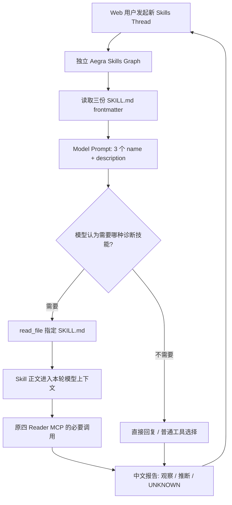

# Issue #75 — Kubernetes Diagnosis Skills：Demo-first 渐进式加载设计 V2

> - GitHub Issue：[ #75 ](https://github.com/Vc-great/kube-triage-agent/issues/75)
> - 状态：**Proposed / 待纯文档修订 PR 合入 main**。本文件是唯一权威的 **V2** 设计与验收 Gate；未合入 main 前不得让 AO 按 V2 实施。
> - 设计基线：2026-10-22 `origin/main=3fa150a86844ce237f4cb4af3ce681bb09a30fdb`（合并 #81 后），实施前必须重新拉取并对照最新代码。
> - 锁定依赖：`deepagents==0.7.28` / `aegra-cli==0.10.8`；执行时以 `server/uv.lock` 和实测源码为准，不自动升级。
> - 本次用户决定：**只求能在 Web Demo 中用 Skill 列表 + 按需读正文 + Reader 完成诊断；不实现旧 Skills Checkpoint 的 pin 来源认证与跨节点恢复专项，不做攻击测试，允许合理重构并快速交付。**
> - 权威验收：本文件 **第 6 节 V2-D0～V2-D8**；Issue 不再重复 Gate。旧版 S0–S9、恢复威胁矩阵属于已废止的实施要求，仅供历史审查，不可再作为当前 S1 STOP 的唯一依据。
> - 历史参考：[原设计 #76](https://github.com/Vc-great/kube-triage-agent/pull/76) → [恢复安全加严 #77](https://github.com/Vc-great/kube-triage-agent/pull/77) → [离线 S1 STOP PoC #80](https://github.com/Vc-great/kube-triage-agent/pull/80)。旧失败结果真实有效，**范围缩小不等于漏洞已修复**。
> - 当前获批动作：纯文档修订与规划 PR；实施时在本修订合入 main 后由 AO/Codex 启动。#80 仍为 Draft/未合并，不能当成可用代码。

## 1. 背景、真正需求与现状

用户要的不是「Skills Graph 专有 Checkpoint 安全框架」，而是一个**可以直观看到 Skills 渐进加载的 Kubernetes 智能诊断 Demo**：

1. Agent 启动或某个新 Thread 首轮时发现三份内置 `SKILL.md` 的 `name / description`，模型提示中出现可用技能索引；
2. 用户询问 CrashLoopBackOff、OOMKilled、ImagePullBackOff 等问题时，由模型判断是否需要读取相应 Skill 的**正文**；
3. 仅当需要时实际执行 `read_file(SKILL.md)`，使用指南再调用现有四 Reader MCP，最后输出有证据或明确 UNKNOWN 的中文结论；
4. 用户不需要配置、上传、管理 Skills；普通问候无需读取完整 Skill 文件。

**区别**：「技能元信息扫描/缓存」与「模型按需读技能正文」是两步。原生 `SkillsMiddleware` 可在 Thread State 中缓存 metadata，并在每次模型调用时注入元信息，**不保证每个模型请求物理上只读一次列表**，但不得在模型未选中技能前把三篇正文全部常驻 Prompt。

### 1.1 已有项目能力

- 既有 `server/src/kube_triage/deep_diagnosis_planning.py` 提供 Deep Agents Planning 图、`write_todos`、四 Reader、预算；`server/aegra.phase-b1.json` 及入口支持隔离 Mock Profile。
- `server/src/kube_triage/deep_diagnosis.py`、`mcp_client.py` 中 Reader 白名单、Namespace `kube-triage-demo`、原参数/UID/16KiB 约束须原样沿用，不重造 Kubernetes 访问层。
- 正式 `server/aegra.json`、Aegra PostgreSQL Checkpointer、正式 `graph.py`、Repair/HITL/Memory 不由 Skills Demo 替换。Issue #78 的 Conversation History/Evidence Store 已经由 [PR #81](https://github.com/Vc-great/kube-triage-agent/pull/81) 合入 main；本需求不改造这两层。
- [PR #80](https://github.com/Vc-great/kube-triage-agent/pull/80) **未合并**，含恰三份 Skill、只读 `SkillSnapshot`、`ReadOnlySkillsMiddleware`、FakeModel/ASGI 探针和失败报告，是可复用的 PoC 素材。它的公开 `build_graph()` 仍无条件抛 `NotImplementedError`，**不是已实现的可运行 Skills Graph**。
- #80 的旧反例 `resume-consumed-pin` 确实在已消费 pin 的旧 Checkpoint 上得到 `1 model / 3 pinned HumanMessage / 0 read_file`；原修订 #77 因此对历史绑定、所有 State 写入口和跨进程恢复设置了很高的 Gate。这属于**超出本 Demo 产品目标的独立安全/兼容专题**。

### 1.2 为什么改变方案

继续维护 Checkpoint 来源摘要、Aegra factory/facade/auth 拦截、copy/head/worker 全入口、旧 pin 历史迁移和逐节点攻击矩阵，工程成本远高于展示三份诊断技能的收益。Skill 本身不需要作为独立持久化对象跨恢复；**已有 Agent Thread/Checkpoint 继续服务正常对话和其他功能**。

本设计是**显式修改 #75 的产品范围和验收标准**，而非把 #80 的 FAIL 改写为 PASS 或静默删除历史证据。旧实验的 FAIL 仍记载于 #80 报告，新实现仅对 V2 的功能 Gate 给出独立证据。

## 2. 目标 / 非目标 / 保留边界

### In Scope

1. 开发者内置 `crashloop-diagnosis`、`oom-diagnosis`、`imagepull-diagnosis` 三份 `SKILL.md`；只读、符合 Agent Skills frontmatter，并打包进后端 wheel。
2. 独立 opt-in 的 `deep_diagnosis_skills` Aegra Graph/Profile，不影响现有正式 Agent / P0；仅六工具：`pods_list_in_namespace`、`pods_get`、`events_list`、`pods_log`、`write_todos`、`read_file`。
3. **元数据先行，正文按需加载**；优先复用锁定 SDK 原生 `SkillsMiddleware`，不提供 `pinned_skills` 的主动应用入口；如果该 SDK 的 pin 生命周期令 Demo 无法稳定工作，允许采用**最小 SkillCatalogMiddleware + 只读 read_file**，但必须明确标注为自定义兼容实现，不能对外声称「原生 SkillsMiddleware」验收通过。
4. 复用当前 `SkillSnapshot` 与 `CompositeBackend`（若选原生）或简化成静态映射。模型访问技能内容**只经确切三条虚拟路径**，不通过用户可修改的 `StateBackend(files)`、宿主文件系统或外部服务。
5. FakeModel / 合成 Mock Reader + 独立 Aegra HTTP/SSE + Web 完成最短可视化闭环；提供一个简单启动命令/环境配置与手工操作步骤。
6. 继承现有 Agent 的普通多轮对话体验；新 Skills Thread 可刷新、再发 Human 消息，继续读到历史。Skill metadata 可再次加载；**不要求保存某次 Skill 正文的「已 pin」状态**。

### Out of Scope（V2 明确取消）

- **不实现、不迁移、不验收**历史 `pinned_skills` / `lc_source=pinned_skill` Checkpoint 的来源认证、回放修复或已消费 pin 的跨节点 Resume。
- 不建设 Aegra 自定义 Graph facade、全局 Thread State 拒写网关、私有 checkpoint binding、签名账本或逐入口 copy/with_config/worker/恢复可信链；旧版第 3.4.1–3.4.4/6.1 恢复攻击矩阵不是 V2 Gate。
- Skills **专属 Graph** 对执行途中取消后的任意节点重放、跨进程断点续跑、导入旧 Skills Checkpoint、time travel/fork 不提供质量承诺。旧实验中断的 Thread 不尝试恢复；重新创建新 Thread 重新诊断即可。
- 不做攻击/渗透专项测试、跨 Thread 竞态压测、复杂多租户权限体系、动态上传/修改 Skill、Script 执行、Host FS/Shell/Repair、Subagent、#69 Offloading/#72 Reviewer 全链路整合。
- 不对真实付费模型批量 A/B，不执行真实 Kubernetes 写操作；若要真实只读集群演示或外发真实信息，另按已有项目授权流程确认。
- 不修改正式 Agent 原有 Checkpoint、HITL interrupt/Resume、Repair 状态与已有旧 Thread。**实验 Graph 不支持老的中途恢复，不意味着全站关闭 Checkpointer 或牺牲正式链路。**

### 不变量（已有约束，不是本期安全专项）

- Reader 执行仍由既有受限服务端工具处理；不变更四工具、Namespace、参数、返回量、UID/Tool ID，Skill 文本不能批准 Repair。
- 不暴露 `execute`、`shell`、`write_file`、`edit_file`、`delete_file`、`task` 等工具；不得因 Skills 部署让正式/P0 工具列表扩大。
- 不把 User/System/Tool 消息或自带 `files` 当作静态技能文件来源；**只读取仓库内置的三份文件**。只做必要的业务行为验证，不展开攻击矩阵。
- CI、真实部署和浏览器未运行时写 `NOT RUN`，不能用 FakeModel 推断真实 Provider 性能/诊断质量；不破坏稳定 Compose/数据库或其它 PR 工作树。

## 3. 最短实现设计

### 3.1 正常加载流程

**注意**：Skill 描述属于应用预置知识，Kubernetes 事实只能来自本轮 Reader 的真实/Mock 回执；不因加载了 Skill 就声称已获得 Pod 证据。Skills 列表可在 Thread 初始加载并随模型调用渲染，不应误解为每条消息都重新读取三份完整 Markdown。

### 3.2 两档实现路径（优先官方、允许快速回退）

**A — 优先：基于 0.7.28 原生 SkillsMiddleware。**

复用 #80 现有三份 `SKILL.md`、`SkillSnapshot`、`ReadOnlySkillsMiddleware` 和读路径限制，使用 `create_deep_agent` 的 `skills` 路由，加载时官方 `ls/download_files` 获取元数据，调用时官方 `read_file` 读取正文。为 Demo **不再由应用写入 `pinned_skills`**，且仅支持新 Skills Thread。若可以用少量适配代码使 pin hook 关闭、元数据和读取正常，采用这条路线。不要为了通过旧历史来源认证而建设新的 Aegra State 安全框架。

**B — 合法备选：最小 SkillCatalogMiddleware + `read_file`。**

若 A 路径仍必须建设旧 Checkpoint 来源认证才能「可构建/可执行」，则保留 `create_deep_agent`、Todo/Reader/Main Loop，关闭原生 SkillsMiddleware 自动装配/替换，仅用少量业务代码：
1. 启动时从固定包读取 frontmatter，生成**三条 name/description/path**，在模型请求系统提示中附加索引；不提前加正文。
2. 提供只读 `read_file(file_path)` 受限工具返回固定包里的指定 SKILL.md，其他路径返回结构化错误；不能把内容当作 Host 文件读取或客户端 `files`。
3. 模型继续自主按需选择 `read_file` 和 Reader；普通对话不读取，工具数量仍为六项。
4. 保留工具结果自然进入 LangGraph State 的现有机制；**不使用 `pinned_skills`、额外 Skill 状态通道或历史 Checkpoint 修补**。

B 是 **Agent Skills 格式 + 同样 Progressive Disclosure 行为的轻量兼容方案，不是 SDK 原生 SkillsMiddleware 实现**。设计和 PR 必须公开标识选用 A/B，验收侧重用户可观察的加载效果，而不是框架品牌。不得用「把三份 Markdown 一起塞进 Prompt」冒充渐进加载。

**可执行决策规则**：先运行小范围组装与 FakeModel 探针，确认 A 能构建、新 Thread 首轮不注入完整正文、模型 `read_file` 路径可用。如唯一阻碍是旧 Skills Checkpoint 来源认证，则**直接采用 B**，不得再扩展 Aegra 服务端可信历史框架；若 A 本身满足功能，则不自造 B。无需等待新的产品确认，但实施 PR 必须解释选型。

### 3.3 Skill 文本、读取及预算

- 三份固定名称、路径、YAML frontmatter（仅 `name` 和 `description` 或 SDK 必需字段），无脚本。复用 #80 的现有内容，不重复编写。
- CrashLoop：观察容器重启、`lastState`、Event 与受限日志；`pods_log` **没有 `previous=true`** 时不得虚构上次容器日志。
- OOMKilled：缺 Metrics Server / 历史峰值工具时，不得把资源耗尽当成唯一确证根因。
- ImagePull：区分 `ErrImagePull` 与 `ImagePullBackOff`；没有 Event/日志充分证据时不臆断凭据、网络或 Registry 根因。
- `read_file` 只读精确三个包内 Skill；每个用户新轮最多读取 2 次，超限明确错误，不无限 Tool Loop；沿用 P0 Reader≤6、模型决策预算与错误返回策略。预算只需覆盖**新 Thread 的正常运行/多轮**，不加 V1 的历史 pin 恢复计数账本。
- 无关问候不必调用工具。FakeModel 可验证确定性的调用协议；如额外实测真实模型/实际读集群需另外授权。
- 不保留 `pinned_skills` 做用户选择技能的快捷方式；新 Thread 后通过正常模型 Tool Calling 阅读。

### 3.4 Aegra / Web 接入

- 新增独立 `deep_diagnosis_skills_entry.py` / `aegra.phase-skills.json`；复用已有 `deep_diagnosis_planning_entry.py`、FakeModel 和 Mock Reader 适配方式。保留原正式 `server/aegra.json` 不变。
- 因 SDK `HarnessProfile.excluded_tools` 可能跨 Profile 合并，**独立进程/Profile** 注册；验证模型确切六工具，正式/P0 的五工具与现有 Registry 不变。
- 增加 `make dev-deep-skills-demo`（实际项目脚本名可适配），用已有 Web Chat UI 与 Timeline 展示 `read_file`、`pods_get`、`events_list`、`pods_log`、中文报告。可用测试资源启动，不重建一套 Web UI。
- 复用 Aegra 自带 Checkpointer 处理普通 Thread、多轮和重新打开对话。**不主动把 Skill 正文 Pin 到 Checkpoint**。已运行的 `read_file` 作为通常的工具结果可能存在 Thread 消息中，这是**正常对话历史**，不能被误称为 Pin 状态，也不要求跨轮强制重新读取。
- 新 Skills Graph 不保证在中途 `interrupt_before/after` 或取消后的任意节点 Resume；不能为了「简化」关闭或更改正式 Graph 的 HITL/Resume。首次启动应新建 Skills Thread，**不要把 #80 实验期间的旧 Skills checkpoint 导入后继续**。
- 不要求对旧 `pinned_skills` Checkpoint 做「可恢复」声明；产品说明要明示：实验图暂不兼容旧 pin 恢复，原有正式 Agent 不受影响。
- Web 刷新/切 Thread 应展示已保存的普通消息和已完成运行；这不同于「恢复被暂停在某个 middleware 节点的旧执行」。若实验图没有 Pending Run Resume 能力，界面不得误显示「已恢复执行」。

## 4. 和 #80 的关系、实施策略

已有可复用的未合并成果：

| #80 文件/内容 | V2 决策 |
| --- | --- |
| `diagnosis_skills/*/SKILL.md` | **复用**三文件与 frontmatter |
| `deep_diagnosis_skills.py` 的 `SkillSnapshot` / Reader/预算逻辑 | **优先复用**并裁剪过度复杂度 |
| `test_deep_diagnosis_skills.py` 的正常加载、预算、Happy/No-Read FakeModel | **复用**、适配 V2 |
| `test_deep_diagnosis_skills_aegra_spike.py` | 可保留有价值的 Smoke，但不作为完整攻击矩阵 |
| `resume-consumed-pin` 历史失败、原报告 | 保留可复现的历史记录，不当作 V2 当前功能 FAIL，也**不宣布已修复** |
| 公开 `build_graph` 总是 `NotImplementedError` | **必须改成可构建可运行的入口**，不能仅继续交付 S1 STOP |

因为 #80 仍为旧基线 Draft，**Implementation Worker 必须先从最新 main 新建独立 Worktree**，选择性带入它的文件或提交，核对与 #81 数据层新变更，不应把整个旧分支直接合并，也不应盲目删光旧反例。可以通过一个新的 Implementation PR 交付 V2；#80 留作历史 PoC，标注 superseded，是否关闭由 PR 主人/后续流程判断，不得把它误当 V2 Implementation 直接合并。

## 5. 执行计划（一个 Implementation PR）

| 阶段 | 入口 | 范围与产出 |
| --- | --- | --- |
| **D0：基线/选型** | 设计修订 Planning PR 已合入 main | 验证最新 main、#80、锁定 SDK、独立 Worktree；最小原生 A/B 选型探针，记录决策 |
| **D1：可运行后端** | D0 通过 | 复用三个 Skill、只读目录、六工具、Metadata→`read_file`→Reader→报告；`build_graph` 真正可执行 |
| **D2：Web Demo** | D1 通过 | 隔离 Aegra profile + FakeModel/Mock Reader + Web Timeline，普通多轮、重进 Thread；旧 pin 中途恢复不测 |
| **D3：验收收口** | D2 通过 | 6–9 合成案例 OFF/ON、工程测试、必要小修、可复制启动说明、中文 Gate 报告、Implementation PR `Refs #75` |

D0–D3 在**同一个 Implementation PR** 中顺序交付，按 V2-D0～V2-D8 验收；不强制多阶段独立 PR，不需另建 SDD 文档。可以按模块做多个提交。只有真实授权方批准才能连接真实 K8s 或付费 Provider；默认仅 FakeModel / Mock MCP。

## 6. 唯一权威 V2 验收 Gate

**重要**：旧版 S3/S4 的历史 pin 反例依然真实，不因 V2 Gate 调整而「转 PASS」。V2 的 Gate 仅评价新增的**限定范围**，不可与旧版历史 Gate 混报。

| Gate | 核验方式 | PASS 判据 |
| --- | --- | --- |
| **V2-D0 基线/旧 PoC 复用** | fetch 最新 main；检查 #80、#81、依赖、隔离 Worktree | 记录 SHA、保留/取用文件清单、决定 A（原生）或 B（最小兼容），不重复开发 |
| **V2-D1 三 Skills 合法** | 包构建 + 静态单测 | 恰三份有效 `SKILL.md`，名称/路径一致；快照来自真实打包资源，不从客户端 `files` 得到 |
| **V2-D2 渐进披露** | FakeModel 轨迹 | 初次模型请求有 3 个 name/description、没有 3 份正文；CrashLoop/OOM/ImagePull 各一次实际 `read_file`，问候 0 次；选 A 时验证原生 `SkillsMiddleware`，选 B 时明确自定义实现 |
| **V2-D3 工具/诊断边界** | FakeModel + Mock Reader（成功/403/404/超时） | Skills Graph 恰 6 模型工具、路径白名单、read≤2/轮、Reader≤6/轮；禁止 Shell/Repair；无证据返回 UNKNOWN，不把 Skill 当 K8s 事实 |
| **V2-D4 实验 Graph 真启动** | 独立 Aegra Mock 服务 | `build_graph` 返回有效图，`/assistants` / Run / SSE 运行成功，模型工具读/Reader 回执链完整；不注册正式 Graph |
| **V2-D5 浏览器可见** | Chat UI 人工/自动化复现 | 三个诊断场景和问候：Timeline 展示 `read_file`、Reader 及中文报告；刷新/重进已完成 Thread 可见普通历史；未进行真人测试则标 NOT RUN |
| **V2-D6 正式链路不回归** | 现有 pytest + 必要 FakeModel Smoke | 原 `agent`、P0、四 Reader、Checkpoint / HITL / Repair / Memory 不被本 PR 破坏；技能图的**旧 pin 中途 Resume** 明列 OUT OF SCOPE/NOT RUN |
| **V2-D7 小评测** | ≥6 合成案例 OFF/ON | 记录 Skill 命中、错误选取、Tool 调用数、证据引用及可测的延迟/Token；未测真实模型质量记 NOT RUN |
| **V2-D8 工程交付** | Ruff、pytest、适用 Web lint/build、`git diff --check`、CI 和 PR Review | 实测项有命令、CI 链接、环境与结论；有最短启动/回退说明；一个 V2 Implementation PR `Refs #75`，不提前关 Issue |

报告状态限定为 `PASS / FAIL / NOT RUN / BLOCKED / UNKNOWN`。V2-D2～D5 属于核心 Demo Gate，必须 PASS 才可把 Skills 称为「已跑通」。针对 Skills Graph 旧 pin 历史的安全来源认证不在本期测试，不允许写成「安全问题已解决」。未运行真实 Kubernetes/付费 Provider，也不能宣称那些验收 PASS。

## 7. 风险、停止条件与回退

- **SDK A 不易移除 pin**：避免旧方案的全局 State Gate，直接按 3.2 选 B；不是修复历史漏洞，PR 中说明牺牲「原生中间件」属性换取可用 Demo。
- **工具扩权/宿主读取**：如果新 Skills Graph 暴露超出六工具、读取宿主任意文件或新增 Repair，可视为行为退化，必须修复或停止；不需要对此做复杂攻防专项。
- **历史 pin**：#80 反例不被掩盖，新图仅承诺新 Thread 正常功能。不能启动旧 #80 已注入 pin 的 Checkpoint 并宣称恢复可靠。
- **Aegra 多进程缓存/Profile**：单独实验配置运行，固定依赖，若必须升级公共 SDK 或动正式 Graph，停止并说明偏差。
- **回退**：关闭新实验 Profile/入口恢复现有 P0/正式 Graph；不删除共享 Thread/Postgres/Checkpoint，不改变旧 Graph 的数据。

STOP：需要未授权真实集群写操作、付费模型批量调用或敏感数据外传；必须修改正式 Reader/HITL/Repair；无法提供确定可用的元数据→按需读取闭环；部署/测试破坏稳定环境。**不因旧版 pin 恢复矩阵无法完成而停止 V2**。

## 8. 历史记录与授权状态

| 日期 | 事项 | 当前判定 |
| --- | --- | --- |
| 2026-10-22 | 原设计 #76 与安全加严 #77 已合并 | 历史 V1 Gate，仅供回顾 |
| 2026-10-22 | #80 S1 STOP / `resume-consumed-pin` Fail Closed PoC | Draft / 未合并；历史 S3/S4 FAIL 仍是事实 |
| 2026-10-22 | 用户批准 Demo-first 缩小范围；本 V2 规划修订 | Proposed；未实施，不预填 V2 Gate PASS |

**产品验收口径**：Skills 列表发现、按需阅读技能、四 Reader 诊断、Web 可复现优先于泛化历史 Checkpoint 来源系统；任何宣称目前完成必须以 V2-D0～D8 的新实现测试为准。

## 9. AO 交接（本修订已合入 main 后方可开始）

- Repo：`Vc-great/kube-triage-agent`；Issue：`#75`；设计：`docs/plans/issue-75-kubernetes-diagnosis-skills.md`。
- 读取**最新 main** 本 V2 设计及 [PR #80](https://github.com/Vc-great/kube-triage-agent/pull/80) 现有成果，独立 Worktree；优先复用 SKILL/只读快照/正常 FakeModel 测试。仅按 D0→D3 / V2-D0～D8 执行，**一个可运行 Implementation PR**。
- 原生 Skills 可轻量跑通则用 A；若 pin 兼容拖住进度则用 B（自定义目录索引+只读 `read_file`），清楚披露类型，不为历史 pin 来源认证扩展系统。
- 仅 Mock/FakeModel/独立测试资源，不运行未授权真实 K8s 写操作/付费模型；不改正式 Graph/Reader/HITL/Repair/Memory/Checkpoint；Skills 旧 Checkpoint Resume 不在本期。
- PR 提交 `Refs #75`、CI/测试/启动说明/中文 Gate 报告；无明确合并授权不关闭 Issue 或自动合并。
