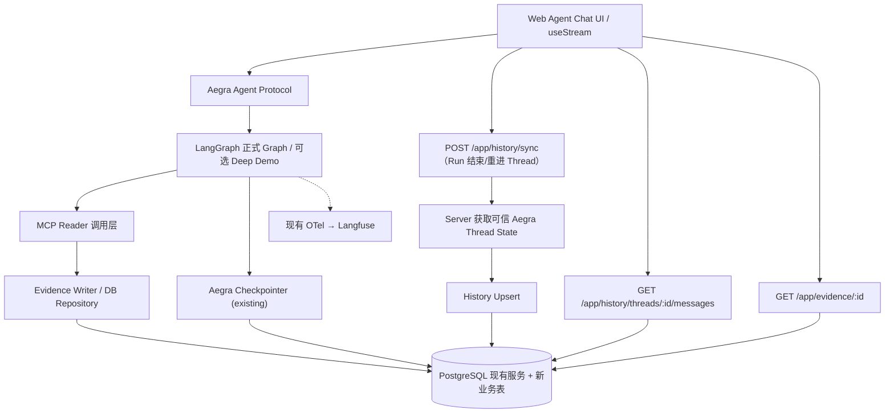

# Issue #78：Conversation History + Kubernetes Evidence Store — 快速落地 Demo Design

> - 需求：[Issue #78](https://github.com/Vc-great/kube-triage-agent/issues/78)
> - 状态：**Proposed / 纯文档 Planning PR**；本文未合并、未获实施验收。
> - 规划分支：`docs/issue-78-conversation-evidence-demo`；[Planning PR #79](https://github.com/Vc-great/kube-triage-agent/pull/79)（Draft）。
> - 设计基线：2026-10-22 `origin/main=b791cffaec0e8f0d665872bdb75ef00e3b9f2029`。实施前重新 fetch；不要沿用本 SHA 当运行基线。
> - 依赖基线：`aegra-cli==0.10.8`，`deepagents==0.7.28`，`server/uv.lock` 以真实锁文件为准。
> - 已批准：**仅本次 Demo-first 设计取向**（用户允许合理重构、希望尽快跑通、不做攻击测试）；代码阶段在设计合并至 main 前不得启动。
> - **唯一权威验收源：本文第 6 节 M0–M9**。Issue 不复制另一套 Gate。
> - 计划实施形式：Planning PR 合并后，**一个端到端 Implementation PR**，在一个独立 Worktree 中按 S0→S3 顺序提交；无需为每层另开实施 PR。未最终验收不得关闭 #78。

## 1. 背景与仓库事实

用户希望将三类数据职责分离：

1. **Conversation History**：浏览器能持续查看完整、按时间排序的 Human / 用户可见 Assistant 文本，刷新、重新进入 Thread 不丢历史。
2. **Checkpointer**：保留 Aegra 内置 PostgreSQL Thread / Run / Checkpoint，用于执行、Interrupt / Resume、State；**本期零重建**。
3. **Evidence Store**：独立保存每次允许的 Kubernetes Reader MCP 工具执行结果、失败状态及证据引用，以便按 `evidence_id` 复查。

当前源代码核对：

- `server/aegra.json` 仅将正式 `agent` 注册为 Graph；Aegra 已连接 PostgreSQL，继续复用现有数据库服务。
- `server/src/kube_triage/graph.py`：`AgentState(MessagesState)`；`_execute_tool` 调用 `mcp_client.call_tool`，组装 `ToolMessage`；审批、Memory 有独立节点。`_llm` 将上下文送模视图与原始 `state["messages"]` 区分。
- `server/src/kube_triage/context.py` 和 `context_summary.py`：当前正式 Summary 只压缩模型输入视图；**没有证据证明正式 Graph 当前删除了 Checkpoint 原始消息**。不将本任务称为现有 Summary 数据丢失修复。
- `server/src/kube_triage/mcp_client.py`：四 Reader `pods_list_in_namespace`、`pods_get`、`events_list`、`pods_log`；固定 `kube-triage-demo`；8s 超时；`_display_result` 裁剪至 16 KiB 字符附近。目前没有单独的业务证据持久化。
- `apps/web/src/providers/Stream.tsx` 通过 LangGraph SDK `useStream` 获取实时与 Thread State，`Thread.tsx` 通过 `threads.search` 维护侧栏，`thread/index.tsx` 从 `stream.messages` 展示消息；现有重新生成从 `parentCheckpoint` 提交。
- `incident_memory.py`、`incident_memory_flow.py` 保存经审阅的跨轮故障经验，不是每次 Reader 原始回执的存储；Langfuse 只负责 Trace。
- Deep Agents `deep_diagnosis.py`、`deep_diagnosis_planning.py` 属于隔离实验 Graph；#72 S1 Reviewer 是离线 PoC，不假设全链路已完成；#69 FS Offloading 是模型虚拟工作文件，不等同于真实 MCP 原始证据。
- 规划时 [PR #77](https://github.com/Vc-great/kube-triage-agent/pull/77) 仍处于 Open（Skills pin/Resume State 边界修订）。本计划不修复该旁路，也不宣称当前 Aegra State 安全封闭；实施时须复核 #77 的修改范围。
- `server/pyproject.toml` 未直接声明独立业务 DB Repository 的驱动/ORM。选择轻量 DB 接入，按实际锁定环境验证依赖，不假设已有隐藏可用公共 API。

## 2. 目标、非目标和快速 Demo 决策

### In Scope（只做能演示的闭环）

- **一次贯通**：Web 新建 Thread → 发送诊断请求 → FakeModel + Mock MCP 产生 Reader 回执 → Evidence 自动保存 PostgreSQL → AI 完成回复 → History 自动同步 → 刷新 / 重进 Thread 读出历史 → 按 `evidence_id` 查到数据库保存的内容。
- 复用同一 PostgreSQL，新增业务表；允许新增少量 Python Repository / FastAPI 自定义 API / 前端 Hook。实施者可为实现闭环合理调整目录和模块，但不能更换 Aegra 运行时或另造 Agent Server。
- 同一 Thread 新旧轮次顺序稳定；重复同步幂等；SSE 展示仍由 `useStream` 驱动；History 专注**用户可见的 Human + Assistant 消息**（不把全部模型内部 ToolMessage 当聊天正文）。
- Evidence 保存本次应用实际收到的 Reader 结果和错误回执，至少工具、参数/目标、观察时间、结果状态、`tool_call_id`、Thread、Graph 与正文/限制标记；业务结果可用 SQL 查询。
- 功能开关默认关闭，迁移和功能验收在独立测试 PostgreSQL 完成。已存在的 Aegra Checkpoint/Thread 原样保留。

### Out of Scope（明确减法）

- 不建新的 Checkpointer / Message Queue / Kafka / Redis Stream / Temporal / S3 / MinIO / 全文检索 / RAG / Embedding / Graph Memory 平台。
- 不做权限模型、攻击测试/渗透测试、不可篡改审计链、分布式事务、跨机高可用、对象存储、繁重性能压测、图形化 Evidence 管理后台。
- 不对旧 Thread 做全量历史迁移；旧 Thread 可继续由 Aegra 原有 UI 读取并标注为 legacy，**新 Thread 才有完整业务 History 保证**。
- 不支持无限长度 Kubernetes 日志和归档：保存的是本次**实际取得且经过已有边界处理**的 Reader 回执，可能已由 MCP tail 限制或应用 16 KiB 裁剪；`original` 仅指该次应用保存的回执正文，不能宣称全量集群日志。
- 不修改 Incident Memory 审阅/撤销流程、不合并正式 Graph 与 Deep Agents Graph、不交付 #72 Reviewer 完整整合（保留后续消费 `evidence_id` 的接口）。
- 不主动为未提交的工具内部思考/CoT 建库；不实现复杂历史分支树 UI。

### 仍然保留的项目边界（不是额外安全工程）

- 不更改现有 Reader 四工具白名单、固定 Namespace、参数校验、错误分类、8s/16KiB 限制；不扩大现有 RBAC。
- 不移除/绕过正式 `/repair-demo` 及 HITL 人工审批，真实 Kubernetes scale、delete、patch、Repair 须另行明确授权。
- 默认仅 FakeModel + 合成 Mock Reader；不得外传真实日志或密钥，不擅自调用付费模型，不碰稳定 Compose/真实 K8s。
- 本期**不安排攻击测试**，但不能用模型伪造的 ToolMessage 直接写成「真实 MCP Evidence」。仅由应用 Host 的实际 Reader 执行路径写入 Evidence；History 只是界面数据，绝不用于 Repair 许可判定。

## 3. 技术方案

### 3.1 总体数据流

关键分层：

- **Graph State 与 History 是两份不同的数据**。`state.messages` 给运行时；History 是完成/可见的展示副本；不把 History 回写 Graph。
- **ToolMessage 与 Evidence 也不同**。ToolMessage 遵循 LLM 配对和当前大小限制；Evidence 作为可查询元数据+存档，可产生 `evidence_id`；缺少 Evidence 不得声称有可回查证明。
- **Langfuse 不当业务库**，只继续保留现有 Trace。
- **不依赖深层 Aegra 内部数据库表**（直接 SQL 解码 Checkpoint 被禁止）。History 同步优先使用 Aegra 的对外 Thread State 协议。

### 3.2 History 写入：选「显式同步」而不是等不确定的 Hook

为 Demo 减少拦截 Aegra Run 的改造：增加 `POST /app/history/sync`，请求只提供 `thread_id`；**服务端**按现有 Aegra SDK/Agent Protocol 查询该 Thread 最新 State（在隔离运行中实际验证），解析 `messages`，幂等写入业务表。不能由浏览器把任意消息全文当作已完成服务端记录直接写入。

触发策略：
1. Web 监测 `useStream` 当前 Run 结束（所用 SDK 若有合适 completion hook 则用，否则通过 `isLoading` 的 true→false 转换）；触发一次 sync。
2. 用户重新打开旧 Thread / History 页面时触发兜底同步。这样即使首次 Run 结束时网络断开，也能在下次打开时补齐可见消息。
3. Sync 失败对正常 Agent 回复不构成中断；UI 显示「历史尚未同步」或明确回退到已有 `stream.messages`。不得伪报已持久化。
4. 正式 Graph 中的 Human 与 Assistant 消息按已有真实 Message ID 去重；如 SDK 不提供稳定 ID，统一设计服务器生成的确定性消息标识。`tool_calls` 相关 AI 只存用户可见文字；不要把所有内部 Tool Message / 控制消息暴露为普通聊天。
5. AI 流式中间态不当成 `completed`；对于 interrupted / failed / cancelled，History 保留已知 Human 和实际可见的响应，状态标记不完整；Run/Thread 状态从 Aegra 读取而不是客户端口述。

**S0 必须核实**：当前锁定 `aegra-cli==0.10.8` 与 Agent SDK 的自定义路由/服务端调用能力、`GET /threads/{id}/state` 实际返回和 `useStream` 完成事件。若 Graph 端直接同步不易实现，可在同 Aegra 服务的受控业务路由内以最小 HTTP SDK 客户端访问原 Agent Protocol。要求避免自请求死锁、鉴权循环或暴露外部 Token；在 Mock 隔离环境用独立 API Token 测通。如果无法实现服务端回读，再选单一、最小可验证的适配点，并在实施 PR 解释偏差；**不为此自建第二个 Agent Server**。

### 3.3 History Schema / API（字段为设计建议，可在 S0 实测微调）

建议 `app_conversations`：

| 列 | 类型 | 备注 |
| --- | --- | --- |
| `thread_id` | TEXT PK | 不预设 UUID 形式；与 Aegra Thread 关联 |
| `graph_id` | TEXT | 实际 Graph ID |
| `title` | TEXT | 第一条 Human 文本截短；禁止空会话乱造 |
| `status` | TEXT | active / interrupted / finished / legacy 等 |
| `created_at, updated_at` | TIMESTAMPTZ | |

建议 `app_conversation_messages`：

| 列 | 类型 | 备注 |
| --- | --- | --- |
| `id` | UUID PK | 业务行 ID |
| `thread_id` | TEXT FK | 会话 |
| `source_message_id` | TEXT | LangChain/Aegra Message ID |
| `role` | TEXT | human / assistant |
| `content` | JSONB | UI 可见消息正文；保留内容块结构 |
| `sequence` | BIGINT | 服务端提交的顺序 |
| `run_id` | TEXT NULL | 仅实际可获得时填写，不猜测 |
| `status` | TEXT | completed / partial / interrupted 等 |
| `created_at` | TIMESTAMPTZ | |

唯一键：`(thread_id, source_message_id)`，针对缺失 ID 的消息，在服务端解析时生成稳定 fallback key；不要用普通内容 hash 当全局唯一键，重复提问仍可能是不同消息。重复 sync 行为应幂等，不重置既有历史顺序。若 Checkpoint 分支重新生成，MVP 默认显示当前分支；旧分支保留不破坏，但完整 Time Travel UI 不纳入。对 `message_id` 重用且正文变化时不得悄然覆盖旧内容：S0 明确当前 SDK 行为，必要时把 `checkpoint_id` 纳入版本键或提示「当前分支」。

HTTP（挂载 Aegra Custom FastAPI app，需在 S0 实测 `http.app` / `enable_custom_route_auth` 的 0.10.8 契约）：
- `POST /app/history/sync`：输入 `{thread_id}`，返回 `{status, added, updated}`；服务端回读 Thread State，Idempotent Upsert。
- `GET /app/history/threads/{thread_id}/messages?limit=&cursor=`：返回按 sequence 的消息 + next_cursor。
- `GET /app/history/threads?limit=&cursor=`：返回会话列表；若保留现有 `threads.search` 则列表先不迁移，优先保证消息查询可用。

UI：`Stream.tsx` 保留实时渲染；`thread/index.tsx` 合并「数据库历史 + 当前 Run 的内存消息」，以稳定 ID 去重、顺序一致。关闭开关或历史 API 不可用时使用现有 UI；不改 HITL/Resume、Todo、SSE 语义。

### 3.4 Evidence 捕获点 / Schema / 查询

优先在 `mcp_client.call_tool` 的**实际执行回执路径**接入公共 `EvidenceRepository`，使正式 Graph 和复用该 Reader 的 Deep Demo 不需各自重复一套 Store；运行来源（Graph/Thread/可用 Run ID）由**受信服务端调用上下文**传入，缺失时按 `unknown`/nullable 处理，绝不捏造。保留现有调用签名兼容，最多新增可选上下文参数。Reader 失败也保存 `status=failed` 和不含秘密的错误分类。

`app_evidence` 建议字段：

| 列 | 类型 | 说明 |
| --- | --- | --- |
| `id` | UUID PK | `evidence_id` |
| `thread_id, graph_id, run_id` | TEXT / 可空 | 对应来源 |
| `tool_call_id` | TEXT 可空 | MCP 调用与 ToolMessage 配对；无法取得时显式 NULL |
| `tool_name` | TEXT | 四个 Reader |
| `namespace, resource_name, resource_uid` | TEXT 可空 | 有界目标元数据；UID 有来源才保存 |
| `arguments` | JSONB | 被允许且已规范化的调用参数 |
| `status, error_type` | TEXT | success / failed / rejected 等；失败错误分类 |
| `payload` | JSONB | 本次受限回执；不超过已批准的 16 KiB 传入边界 |
| `is_truncated` | BOOLEAN | 是否由应用裁剪（不能判断上游日志是否完整） |
| `sha256` | TEXT NULL | 保存 payload 的确定性字节摘要，仅作一致性检查 |
| `observed_at, created_at` | TIMESTAMPTZ | 时间 |

注意 `mcp_client._display_result` 使用字符串裁剪（不是严格 UTF-8 字节）；S1 需实际检查现有 16 KiB 语义，**不得放宽**；如将响应类型改为对象来传 `truncated` 标志，需保证原 ToolMessage 文本结构与测试保持兼容。可使用 `payload={"ok":true,"result":"..."}`，不要再用原文直接污染 audit 日志。

最短实现：`INSERT` 同事务完成一条 Evidence，返回 ID；`GET /app/evidence/{id}` 查询存在记录，默认返回明确的 success/failed、来源、观察时间和正文。模型可见 `evidence_id` 可放进工具结果的受控 metadata 或 `ToolMessage.artifact`（先实际核对 SDK/UI 契约）；**不要把模型随意生成的 ID 当作有来源的 ID**。如果不能保留 ToolMessage 结构，首版可仅在业务 DB/查询 API 关联，在报告里不强制渲染点击式引用。

Store 写入失败的 Demo 容忍策略：
- **只读诊断**：保持原 MCP 结果返回与 LLM 正常执行，同时明确标志 `evidence_persisted=false` / 应用日志报错，不向 UI 承诺可回查；可在报告中标注本次证据未归档。
- **Repair / HITL**：本期不改既有审批/写入链路，也不以新增 Store 回执提供任何授权；未来若将证据作为修复许可的依据，必须单独设计。当前测试必须证明新 Store 故障不会绕开已有原审批。
- 业务 DB 不可用：有界超时、无无限重试、不重打 MCP 工具；回滚开关应仍可使用原正式 Agent。

### 3.5 数据库和依赖

- 现有 PostgreSQL（`infra/compose.yaml`，PG18 镜像），新增独立 `app_*` 表及小规模 SQL 初始化/迁移。**不修改 Aegra 自带 Thread/Checkpoint 表**。
- 技术取舍：优先 Python `psycopg` 3 + 简单 SQL / 连接池；Python 包若需新增则在 `server/pyproject.toml` 中显式声明并更新锁文件。无需全套 SQLAlchemy Models / Alembic 起步；实现者如发现已有成熟迁移工具可沿用，不为 Demo 引新平台。
- 迁移：显式幂等 DDL / 小脚本，测试 DB 首次创建、再次执行无变化；禁止对稳定库自动 DROP/TRUNCATE。
- 环境变量：`APP_HISTORY_ENABLED=false`、`APP_EVIDENCE_ENABLED=false`（默认）；数据库连接复用既有 POSTGRES 环境变量；默认关闭时不能因新增 DB 初始化错误阻断原路径。演示 Profile 在独立环境启用两个开关。
- 暂不设超复杂保留策略：Demo 数据可在独立数据库中手动管理；部署说明标记大结果、密钥、共享访问风险，但不开发权限系统。
- 开发环境、测试 compose、API 路由接入的端口/路径由当前运行镜像验证后固定；不能假设所有跨容器/本机 URL 一样。

### 3.6 方案对照和选型

| 方案 | 取舍 | 结论 |
| --- | --- | --- |
| Aegra 继续 Checkpointer + 自定义 `app_*` PostgreSQL 表 | 复用基础设施、可查询；需要少量 Repo/API 代码 | **首选** |
| `PostgresChatMessageHistory` 完整接管消息 | 增加独立消息框架但不解决 UI/HITL/版本合并 | 不引入 |
| Checkpoint History 直接遍历作为 UI 永久历史 | 无新表，但 Graph Summary/历史分支/状态 API 生命周期与业务聊天耦合 | 不推荐长期依赖 |
| Langfuse 直接当 Evidence DB | Trace 很适合调试，不提供业务证据 CRUD/生命周期的明确契约 | 不选 |
| S3 / 文件 / SeaweedFS / RustFS | 适用于大结果；Demo 最大 Reader 返回有限 | 暂不部署 |
| 新 FastAPI Server / Kafka / Outbox | 增加部署成本与故障点 | 本期不选 |

### 3.7 主要风险、回退与决策点

- **Aegra Custom Route 与服务端 Thread State 回读**：必须锁版本核实；如无法使用，则只在 S0 更换 History 同步入口，不为它新建一个 Agent Server。S0 发现长期循环调用死锁或 SDK 无可用接口则停止并报小范围替代方案。
- **重复/重生成**：Message ID 未必在全部阶段稳定；基于实际 State 做唯一键与顺序测试。MVP 可不显示历史分支树，但禁止合并成重复泡泡/悄然覆盖。
- **旧 Checkpoint**：旧 Thread 继续可从 Aegra UI 查看；不强制回填。新增 Graph/工具节点不得更名破坏待审批的旧 State。
- **结果截断**：明确是应用已接收的受限快照；无法复现上游被截掉的行。
- **DB 故障退化**：Evidence/History 单独标注错误，不把写失败说成成功；关闭功能开关可直接回退到现有 UseStream / MCP 路径。
- **当前并行 PR**：PR #77 尚 Open；若它修改 State/Skill 恢复接口，只按需重验当前受影响文件，不必等全部 Skills 功能完成。

## 4. 具体代码落点（建议，不强制增加不必要的抽象）

后端：
- 新增 `server/src/kube_triage/app_storage.py` 或 `storage/{db,history,evidence}.py`（根据最终文件规模择一；**优先少文件**）。
- 新增 `server/src/kube_triage/app_routes.py`（Aegra 自定义 FastAPI app；实测对应 0.10.8 配置）。
- 小改 `mcp_client.py`、`graph.py`（仅工具调用上下文透传）、`server/aegra.json`、`config.py`、`server/pyproject.toml` 与环境配置。
- 新增 `server/migrations/` 下幂等创建脚本；不直接操作 Aegra 管理表。
- 新增 `server/tests/test_app_persistence.py` + 有针对性 E2E。

前端：
- 小改 `apps/web/src/providers/Stream.tsx`、`apps/web/src/components/thread/index.tsx`；必要时新增一个 `useConversationHistory` Hook。
- `apps/web/src/components/thread/history/index.tsx` 原有 Thread 列表可先不改；MVP 只需旧列表正常，选中后能展示 DB History。

文档：
- 验收后修改 `docs/architecture.md`、`README.md`、必要的 `docs/dev01-deployment.md`，新增简短的 Demo 使用步骤；Planning PR 当前阶段不改这些现状文档。

## 5. 实施顺序：一个 Implementation PR，不逐阶段独立 PR

| 顺序 | 工作 | 最小可观察交付 | 条件 |
| --- | --- | --- | --- |
| **S0 — SDK/DB Spike** | 最新 main、#77 差异、Aegra Custom Routes/State 回读/Run completion hook 验证；迁移方案 | 简短 Spike 记录与 Smoke | M0、M1 |
| **S1 — Evidence vertical slice** | 业务表、实际 Reader 执行捕获、Evidence 查询 API、功能开关 | Mock Reader 返回后 SQL 与 GET 能查 | M2、M3 |
| **S2 — History vertical slice** | Thread State sync、History 查询、前端整合 | 连续两轮诊断后刷新与重进保留 Human+AI | M4、M5、M6 |
| **S3 — E2E 收口** | 真实隔离 PostgreSQL、FakeModel/Mock MCP、断连/旧 Thread/Resume/关闭回退、文档与 CI | 视频或步骤式人工复现、测试报告、PR | M7、M8、M9 |

- 一个独立 Worktree，S0–S3 可以在同一实施 PR 的连续提交中完成；每步 Gate 验证后继续，不需要重复用户确认早已批准的**离线** Mock/DB 范围。
- 如果出现明确停止条件，保留最小可复现失败与局部实施代码，报告 BLOCKED，**不伪装整体验收通过**。
- Implementation PR 使用 `Refs #78`；可在最终 Gate 通过并获准合并的版本使用 `Closes #78`。不自动合并，除非当前任务有单独明确授权。

## 6. 唯一权威验收矩阵

| Gate | 测试 / 环境 | PASS 条件及证据 |
| --- | --- | --- |
| **M0 基线与隔离** | `git fetch`、查看 #77、依赖版本；独立 Worktree + 独立 Compose | 记录实时 main SHA/PR/环境，未触碰稳定服务 |
| **M1 兼容入口** | Aegra 0.10.8 + 隔离 PostgreSQL；Custom API / Thread State Smoke | 自定义路由可访问；后端可按 Thread 读取 Aegra State；未引入第二 Agent Server |
| **M2 Evidence 成功/失败** | FakeModel + 合成 Mock Reader（含 403、404、Timeout） | 每次实际 Reader 回执入库，`evidence_id` 可通过 API 回查，`tool_call_id`/status 关联正确；无虚构成功 |
| **M3 截断与 DB 故障** | 合成长结果 / DB 断连 | 保持原 8s/16KiB/四 Reader 限制；报告截断；持久化失败显式标记且不重复调用 MCP |
| **M4 History 轮次与幂等** | 同 Thread 2–10 轮，重复 sync | Human+用户可见 AI 顺序完整，重复同步零重复，同文本不同轮不会被合并 |
| **M5 Web 真实交互** | 浏览器 Agent Chat UI + Mock/DB | 新 Thread 两轮诊断、刷新/重进历史可见；当前 Run 仍正常流式、Tool/Timeline 展示，API 断开有明确降级 |
| **M6 Run 生命周期** | cancel / fail / regenerate / SSE reconnect（基于可用 SDK） | 不把半截输出当已完成；无重复历史泡泡；无法支持的历史分支 UI 明确不在本期但数据不被静默覆写 |
| **M7 原行为回归** | 既有 pytest + Mock Repair/HITL/Memory + Aegra Checkpoint/Resume | 现有审批、旧 Thread、正式/Deep Demo 基础调用无回归；真实 K8s 写入 NOT RUN |
| **M8 开关与持久库** | 功能双关，迁移两次，独立 PostgreSQL 容器重启 | 双关恢复原 UI/Graph；开时重启后 History/Evidence 可查；幂等 DDL 不删除现存记录 |
| **M9 工程交付** | `uv run --frozen ruff check src tests` / `pytest` / `pnpm lint` / `pnpm build` / `git diff --check` / CI | 实际执行项记录命令、结果、环境与 CI/PR URL；文档准确；状态按 PASS/FAIL/NOT RUN/BLOCKED/UNKNOWN |

验收刻意**不设攻击测试 Gate**，不要求性能指标固定提升，不要求真实付费模型或真实 Kubernetes 证据；上述 Mock E2E 仅证明 Demo 技术闭环。

## 7. STOP、保留项和验收报告口径

必须 STOP：无授权真实 Kubernetes 写入/删除/Repair 或 RBAC 扩权、破坏老 Checkpoint/Repair 审批、Aegra 当前版本自定义路由/状态获取根本不成立且需新 Agent Server、未知来源消息伪装「真实 Reader」证据、依赖升级迫使主 Graph 出现不可逆故障、数据迁移会删稳定库、必须向云端批量发送真实敏感数据。

允许 Demo 简化：不做威胁建模/攻击用例、不引入额外 auth 权限层、不要求严格 exactly-once 分布式保证、不做旧历史全量迁移、不建设 S3、暂不提供 Review UI、新模块可按演示需要做较大代码整理。保留已有授权边界是兼容性要求，不等于本期另做安全专项。

实施 PR 必须把 `PASS / FAIL / NOT RUN / BLOCKED / UNKNOWN` 与实证一一对应。未执行真人浏览器操作则 M5 `NOT RUN`；无真实集群测试不得声称真实 K8s PASS。必要时 S0 可先把一个 API 兼容性假设判 BLOCKED，再基于实测改小方案并提交审阅。

## 8. 变更记录

| 日期 | 事项 | 状态 |
| --- | --- | --- |
| 2026-10-22 | Issue #78 Demo-first 规划；设计基线 `b791cffa` | Proposed；无代码改动，无 Gate PASS |

## 9. AO 交接（Planning PR 合并 main 以后使用）

- 仓库：`Vc-great/kube-triage-agent`；Issue：`#78`。
- 唯一设计：`docs/plans/issue-78-conversation-evidence-demo.md`；当前批准顺序：`S0→S1→S2→S3`。
- 从最新 `origin/main` 建独立 Worktree；先按 M0/M1 验证 Aegra 0.10.8 服务端 History 同步可行，再纵向实现 Evidence → History → Web。
- 只使用 FakeModel / Mock MCP / 独立 PostgreSQL；真实 Kubernetes 写、RBAC 修改、付费模型、敏感日志外传未获授权，一律不执行。
- 不做攻击测试，不建新服务/队列/S3，不误改既有 Reader/Repair/Memory/HITL。
- 交付一个可运行的端到端 Implementation PR（`Refs #78`）、真实测试报告与 Demo 手工操作步骤。规划合并前本段不能直接作为实施授权。

## 参考

- [Aegra 配置与 Custom Routes](https://github.com/aegra/aegra/blob/main/docs/reference/configuration.mdx)：正式实施前复核当前锁版本支持。
- [LangGraph Checkpointers](https://github.com/langchain-ai/docs/blob/main/src/oss/langgraph/checkpointers.mdx)：Checkpoint 是 State snapshot / resumability，不是聊天业务表。
- [Agent Chat UI](https://github.com/langchain-ai/agent-chat-ui)：保留现有 SSE 与消息显示契约。
- 仓库 [AGENTS.md](../../AGENTS.md)、[agent-workflow.md](../agent-workflow.md)、[规划模板](TEMPLATE.md)。
