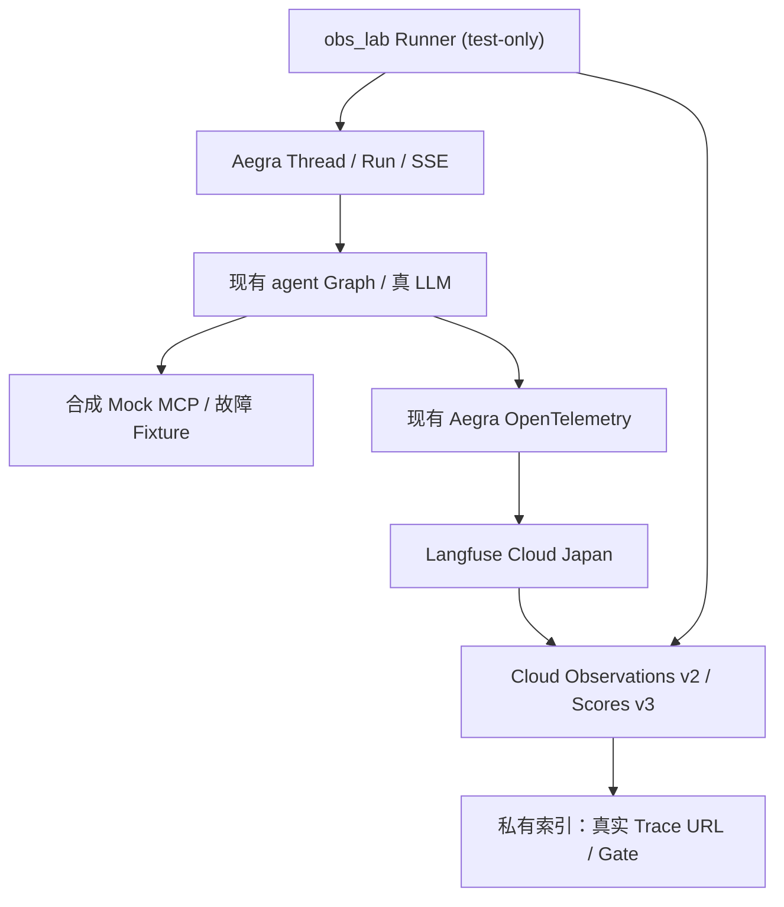

# Issue #91/#92：Observability Fault Lab V1 — 真实模型、故障注入与 Langfuse 可回查实验

> - GitHub Issues：[Phase A/B #91](https://github.com/Vc-great/kube-triage-agent/issues/91)；[Phase C/D #92](https://github.com/Vc-great/kube-triage-agent/issues/92)
> - 状态：**Proposed（Planning PR 未合入，不是已实现）**
> - 规划 PR：[Draft #93](https://github.com/Vc-great/kube-triage-agent/pull/93)（仅设计，不代表批准或实现）
> - 设计基线：2026-10-26，`origin/main=7b3a9bd8a507145a95fe39e5b47f173a9673d48e`（实施前重新 `git fetch origin`）
> - 适用版本：以当前仓库锁定的 Aegra 0.10.8、LangGraph 1.x、Langfuse Cloud Japan 为准；外部 API/SDK 运行时重新核对
> - 规划评审：用户认可“真实模型 + 合成 Mock 故障 + 云端 Langfuse 可见”方向，**设计合入 main 之前不实施**
> - 当前允许实施范围：规划合并后仅 **#91 Phase A → Phase B（A Gate 通过后）**；**#92 Phase C/D 后置**
> - **唯一验收标准权威来源：本文件 §5**。两个 Issue 与 Implementation PR 只链接 Gate，不复制成第二套标准。

## 1. 背景与现状

用户希望通过一条命令批量模拟 Agent 故障，**实际调用真实模型**，最终直接点开 Langfuse Cloud Japan 中每个场景的 Trace，学习定位工具超时、403、业务错误、LLM 429、重复调用、Summary 与证据质量问题。目标是可以运行和可追踪的训练实验，不是新的生产可观测平台。

当前 `main` 已有：
- `scripts/dev.py`、`scripts/compose_with_langfuse.py`、`infra/langfuse.compose.yaml`：`make dev-mock` 等真实 LLM + 合成 Mock Reader 场景可通过 Aegra 原生 OTel 向 Langfuse Japan 导出；[#39 验收](../issue39-langfuse-validation.md)仅云端确认过普通 LLM Trace，**Tool Calling A06 和 Summary A07 尚 BLOCKED**。
- `server/src/kube_triage/graph.py`：正式诊断 `agent` Graph 的 LLM/Tools、Reader 执行，模型决策最多 4 次、工具执行最多 6 次，独立 Repair/HITL 路由不变。
- `server/src/kube_triage/mcp_client.py`：四个 Reader 工具、固定 Namespace、严格参数、调用超时 8s、结果 16KiB，上游和内层业务错误的区分。
- `server/src/kube_triage/mock_mcp.py`、`server/tests/fixtures/`、`eval/issue12/blind-v1.json`：已有合成 Reader、CrashLoop/ImagePull/Healthy/证据不足案例；`review-web` Fixture 有 403 与 8.2s 慢响应，但其 Reviewer 入口是 FakeModel。
- `scripts/eval_issue12.py`、[#14 指标定义](../issue14-metrics-design.md)：Aegra Thread/Run/SSE、Tool Call ID 配对与离线指标可复用；不能以旧指标冒充新的实时 Langfuse 运行。
- `scripts/skills_demo.py` 强制 `OTEL_SDK_DISABLED=true`、`DEEP_DIAGNOSIS_FAKE_MODEL=true`。**不得直接复用此启动器并宣称产生真实模型 Trace。**
- 当前开放 [PR #90](https://github.com/Vc-great/kube-triage-agent/pull/90) 开发 #69 文件笔记，与本实验无交集；不可修改其分支/资源。

目前尚未验证：实际真实模型 Tool Span 能否完整显示、Tool 业务失败能否正确标记、Session/Run/Trace 唯一关联、云端故障场景查询与链接索引、Score 关联。所有新 Gate 初始 **NOT RUN**。

## 2. 目标、非目标和边界

### In Scope
1. 一个隔离、test-only 的 **Observability Lab Runner**（优先 Python），调用当前 `agent` Graph 的 **Aegra `POST /threads` 与 `POST /threads/{thread_id}/runs/stream`**，始终由真实 LLM 自主决定是否调用工具；Mock MCP 注入确定性合成结果。
2. 全部 10 组场景 S01–S10，每组默认 2 Run，每 Run 独立新 Thread（S09 则同 Thread 内多轮）；不将未发生的工具调用强制拼成“真实模型 Trace”。
3. 复用 Aegra **唯一** OTel Trace Exporter；最小补充 Tool Outcome、Summary Outcome 等必要且脱敏的业务 Span/attribute/score。可按 batch/scenario/run/graph/thread 筛选。
4. 使用 **Cloud Observations API v2** 实际反查 Trace ID；`index.html`、`index.md`、`manifest.json` 仅存储在 `.local/observability-lab/<batch_id>/`，内含 **真实 Langfuse URL**，不猜测 project ID。
5. 在 Phase C/D 采用确定性规则与（可选）独立真实模型 Judge 添加 Langfuse Scores；Score 来源、人工评分与自动评分严格区分。

### Out of Scope
- 不引入 Prometheus/Grafana/Loki/Collector、第二套业务 Dashboard、第二个 Langfuse Tracing SDK exporter，也不迁移/重构正式 Graph。
- 不对真实 Kubernetes 制造故障，不调用任何真实 Repair，不审批/Resume 真实写入，不扩大 Reader RBAC/Namespace/工具白名单。
- 不修改 Deep Agents #69/#72 的实验 Graph 或旧 pending Checkpoint；不启用 Memory/Evidence/History 正式数据外发。
- 不承诺真实模型一定会重复调用、一定会幻觉，或 Provider 429 一定由内部 SDK 重试；如果未触发必须客观记录而非伪造。

### 授权、安全、数据与环境
- 用户已明确批准本实验**有限批次的真实模型调用**和合成测试数据；严格只将**全新人工合成**问题、Mock Pod/Event/Log/ToolMessage 送往当前已配置的 Provider 和 Langfuse Japan。真实 K8s/用户历史/密钥/kubeconfig/原始 Header/私有日志禁止外发。
- 原 `AGENTS.md` 的 Reader Fail Closed、Namespace、8s/16KiB、Repair/HITL、Checkpoint/SSE 兼容性仍为强约束；`TRIAGE_ENV=test`、`REPAIR_ENABLED=false`、不挂 K8s kubeconfig。模型足额资源**不等于无界循环**。
- 使用独立 Worktree、独立 API/PG/Redis/Mock 资源和标签；先检查端口/卷所属，启动器仅停止本次创建资源。工作树中的私有 `.env` 由属主/权限检验提供，**不得从其他工作树偷读/复制凭据**。首次运行缺少必要配置时以 `BLOCKED` 明确报告。
- 首轮 Smoke 1 Run；#91 A/B 完整计划 S01–S08 各 2 Run，共 16 Run；#92 C 部分 S09/S10 各 2 Run 共 4 Run；Phase D 显式完整回归 20 Run。每次批量需显示并强制 `max_runs`、单次 Run 超时、模型/工具决策预算；默认并发 1、有限重试，不自动补跑失败 Run。Provider 底层重试次数需通过有效请求链路核对，异常停止批次而非无限重试。
- 私有完整轨迹/Trace URL/Provider Token 仅留 `.local` 0700/0600；公开 PR 仅记录合成场景名、去敏测试命令、状态、统计与可向授权人分享的 Trace 链接（如共享会暴露 Prompt 内容，先检查项目访问权限）。

## 3. 方案设计

### 3.1 数据流与组件边界

推荐复用 `scripts/eval_issue12.py` 的 Agent Protocol、SSE 终止/错误、State/History 和消息协议检验；将新需求封装在 `scripts/obs_lab.py`（Runner）、小型 test-only 场景清单/Fixture 和可选的脱敏观测辅助模块。可用独立 Compose test-only Profile 或最小增量启动入口；不要改已存在的生产默认值。无需前端专用页面。

**故障注入原则：** 由测试 Runner 的可信场景清单选择 Fixture，不由用户 Prompt 任意决定 Mock 权限/外部 URL。只复用原四 Reader API Schema，不新增能被模型调用的测试后门。进程级 Mock 数据集选择要保证不同场景不会在并发时串线；必要时每场景独立测试实例。S07 的 LLM 429 需要仅本地测试请求转发桩：首请求返回合成 429，后续请求通过原授权 Provider 端点转发；禁止记录/回显 Authorization header，禁止跳过 TLS 校验，限制目标与重试次数；不能以直接伪造模型返回替代真正的恢复调用。若 Aegra/SDK 无法安全注入，标记 BLOCKED 并停止对应场景，不改正式 SDK 请求链。

### 3.2 10 个场景与预期观测

| ID | 数据/故障 | 观察点 | 判定界限 |
| --- | --- | --- | --- |
| S01 Healthy | 全新合成正常 Pod | Agent→Generation→Tool→Generation；Session | 不将 Ready 等同业务端到端正常 |
| S02 CrashLoop | 缺失配置路径日志 | 选择 pods_get/pods_log、结论引用 | 未调用工具则记录实际行为，不拼接工具 Trace |
| S03 ImagePull | 镜像 NotFound/Unauthorized Event | 目标 UID 与 Event 归属 | 仅工具有真实证据时判诊断成功 |
| S04 MCP Timeout | pods_log 延迟超过现有 8s | 超时/时间线/最终不确定性 | HTTP/SSE 200 不等于 Tool 成功 |
| S05 Reader 403 | 模拟权限拒绝 | 分类 permission_denied、重试 | 不通过扩大 RBAC 修复 |
| S06 Business Error | MCP HTTP 成功、业务 `ok=false` | wrapper_success vs business_error | 不凭 Span OK 认定业务成功 |
| S07 LLM 429 | 第一请求合成 429、后续真 Provider 调用 | 真实重试 attempt / 是否恢复 | 若 SDK 不重试记录实际 FAIL；不伪造成功 |
| S08 Duplicate Tool | 合成场景诱发重复查询 | 同参数 Tool Call 次数/阶段/原因 | 模型未重复时记 NOT_TRIGGERED，不算故障复现 |
| S09 Summary | 同 Thread 多轮合成历史达到实际触发阈值 | Summary adopted/fallback、Token/延迟 | 未触发摘要不得填 PASS |
| S10 Wrong Diagnosis | 证据不足/无关 Warning Event | Ground Truth、幻觉/过度归因 | 正常 Run ≠ 根因正确；判断需可信评分 |

### 3.3 可观测契约（最小新增）

- 已有 OTel trace/context/session/run 标识优先；新增可过滤的 `environment=obs-lab`、`batch_id`、`scenario_id`、`case_version`、`graph_id`、模型与 Prompt 版本（仅非敏感标识）。以 Aegra 实测 Span 属性传播情况决定设置位置，不从客户端任意输入信任生产身份。
- `tool_outcome` 至少区分 `success / timeout / permission_denied / business_error / policy_rejected / budget_skipped / unknown`，附允许的 Tool 名、Tool Call ID（受限本轮标识）、时间/错误种类。**外层协议成功/内层 `ok=false` 为业务失败**。先验证原生 Aegra Span 是否包含 Tool，缺失才用最小自定义子 Span，不复制上报相同 Generation。
- `context_summary_outcome` 可为 `adopted / fallback_timeout / fallback_invalid / skipped`，只在真实控制流触发并赋值。不能因为 Summary 的 Generation Span 状态为 OK 就推断摘要被采纳。
- State/Checkpoint/History/原始 ToolMessage 正文不写入自定义 metadata；若 Aegra 自动 Span 默认包含合成 Prompt/Message，仅测试隔离数据可上云。禁止任何真实凭据和真实集群数据。
- Trace/Run 状态分别记录：`protocol_status`、`tool_outcome`、`diagnosis_score`。Span ERROR 用于真实异常，适当采用可筛选的业务结果字段，不改 Graph 错误语义以美化 Dashboard。

### 3.4 Cloud API、Trace 唯一映射与报告

- 唯一 Trace 摄取仍通过 Aegra OTel→Langfuse Japan。**实际查询 API 为 `GET /api/public/v2/observations`**，可用 `sessionId`、`environment`、时间窗与 metadata 过滤；返回的是 observation rows，**按 `traceId` 分组**，不能用 `run_id` 冒充 Trace ID。多个候选必须核对 trusted Run metadata / root / 时间窗；关联仍歧义则 `UNKNOWN`，不猜。
- 项目 ID 通过认证的同一 Langfuse 公共 API/返回字段确定，再组装 `https://jp.cloud.langfuse.com/project/<project-id>/traces/<actual-trace-id>`；验证 Cloud API 已读到该 trace 下的 Generation/Tool 等 Observation，再标 `VERIFIED`。网页 UI 手动打开另记 UI PASS/NOT RUN，不把自动 API 成功当成人工打开过页面。
- API v2 可能因不带 `x-langfuse-ingestion-version: 4` 的旧 OTLP 导出延迟约 15 分钟；先实测当前 Aegra 兼容性，兼容才考虑仅在测试导出器设置该 header；否则有界轮询并区分 `PENDING_INGESTION` 与最终 `BLOCKED`，不要误报网络失败或静默启用第二套 SDK Exporter。新 API 实现以 [Langfuse Public API](https://langfuse.com/docs/api-and-data-platform/features/public-api) 为准。
- 所有 API 读取必须分页/有界时间窗口，批次可断点**只读重建报告**；不为补 Trace 重复发起付费 Run。云端导出/Score 失败不得改变 Agent 运行行为。
- 首期报告可为纯 Markdown/JSON 清单，Phase D 加静态 HTML 索引；不新增服务端或 Web 菜单。输出每个 `scenario_id`、`thread_id`、`run_id`、Cloud `trace_id`、真实链接、Root/LLM/Tool/Summary 状态、评测状态、缺失原因。

### 3.5 Scores 与评价口径（#92）

- 基础确定性规则：`tool_protocol_valid`、`fault_handled`、`evidence_uid_matched`、`unnecessary_retry`、`grounding_rule`。`S08` 重复调用是否不必要必须结合时机/变化数据，不因同参数自动扣分。
- `diagnosis_correct` 依据冻结人工 Ground Truth，单纯字符串匹配只能叫 `rule_check`，不能冒充人工诊断正确率；选配 LLM-as-Judge 时独立记录 `judge_model`、`rubric_version`、`judge_run_id`、可能失败和样本数。
- Score 写入推荐 Runner 独立使用 Langfuse Public Scores API（创建接口遵循官方文档），读取采用 Scores API v3；**不要在 Aegra Trace 侧再接一个 Langfuse SDK exporter**。Token/费用只对可观测 Usage 使用；模型代理私有计费不得按公开价格估计成实账单。
- 聚合统计 S01–S10 按 Run/Scenario 分母分别列 `run_success`、`tool_failure`、`diagnosis_quality`、Trace 已摄取比例；缺失统计为 NULL/UNKNOWN，不补零。

### 3.6 方案比较

| 路线 | 优点 | 风险/代价 | 选择 |
| --- | --- | --- | --- |
| Aegra OTel + 真实 LLM + Mock MCP + 独立 Runner | 复用原 Graph、真实行为与可控故障，变更少 | 需要校验 Span 关联、API v2 延迟 | **采用** |
| 原 Reviewer FakeModel Demo 直接开启 Trace | 快速、已有 403/Timeout | 没有真实模型，不满足目标；现入口默认 OTel OFF | 只复用 Fixture |
| 为所有 Graph 接入 Langfuse SDK/Collector | 可自定义观测多 | 重复 Export、干扰正式链路/升级成本 | 不采用 |

## 4. 分阶段执行

| 阶段 / Issue | 实施内容 | 独立交付 | 下一阶段条件 |
| --- | --- | --- | --- |
| **A / #91** | 独立入口 + 真模型 + Mock、S01–S03、Cloud API 验证 LLM→Tool→LLM | 首个 Implementation PR（或一 PR 内先形成独立 A commit/Gate） | A0–A5 全部 PASS；Cloud Tool 层明确可见 |
| **B / #91** | S04–S08 故障 Fixture、Tool Outcome、429 桩、Trace 链接清单 | 独立 PR 或 #91 同一实施 PR 的后续 commit/报告 | B0–B5 全部 PASS 后关闭 #91 |
| **C / #92** | S09/S10 Summary/错误诊断、规则+可选 Judge 的 Scores | #92 实施 PR、真实模型/云端评测 | C0–C4 全部 PASS |
| **D / #92** | `make obs-lab` 一键 10×2、静态索引、Report 回查、教程 | 最终验收及关闭 #92 | D0–D5 全部 PASS |

执行前重新读取最新 `main`、Issue/PR、AGENTS、SDK 锁版本及相关代码；独立 Worktree。Phase A/B 经合并的 Planning PR 才可执行，Phase B 必须先收到 A 实际云端证据。#92 的 C/D 依赖 #91 收口，不随 AO 的 #91 提示词自动启动。

## 5. 唯一权威验收 Gate（全部初始 NOT RUN）

| Gate | 测试与 PASS 条件 | 必须保留的证据 |
| --- | --- | --- |
| **A0 基线隔离** | 记录实施时 `origin/main` SHA、SDK/Provider 配置状态、无 PR #90 冲突；测试 API/MCP/PG/Redis 归属独立，`TRIAGE_ENV=test`、Repair OFF、无真实 K8s kubeconfig | 命令、SHA、资源归属摘要 |
| **A1 真实调用** | 真实 Provider 返回实际模型标识；通过 Aegra HTTP Thread/Run/SSE 运行 S01–S03；FakeModel 不得替代，模型成功与最终 Run 成功分别记录 | Run ID、Provider 响应元数据、脱敏终态 |
| **A2 Cloud 摄取** | 同一 Langfuse Japan 项目 Cloud Observations v2 查到实际 S01–S03 Trace、Session 与可信 Run 关联，Trace URL 可打开（UI 人工访问单列） | Cloud API 摘要、真实 trace ID/link |
| **A3 完整链路** | 至少一个需要 Reader 的真实模型 Run 能在云端观察 LLM→Reader Tool→LLM、父子/时间线及 Tool Call ID 通过 State/History 核对；缺 Tool Span 必须最小补全后复测 | 工具数、Observation 类型/父子关系、Tool Call 匹配 |
| **A4 非污染与关闭** | 合成数据/密钥审计、OTel OFF/网络故障不改变 Agent 诊断执行结果；不影响正式 Aegra/Reader/HITL/Memory/SSE | 负测、无敏感输出、回归结果 |
| **A5 交付** | `make obs-lab-smoke` 可重复、单场景运行报告，Ruff/pytest/适用 CI；真实 Smoke 执行与 Cloud 链接同时 PASS | PR + CI、命令、Cloud 链接 |
| **B0 注入正确** | S04–S06 故障由 Mock MCP 受控引发，经过现有合法 Reader 工具路径；8s/16KiB/白名单不放松 | Fixture 断言、工具轨迹 |
| **B1 错误语义** | S04 timeout、S05 403、S06 `ok=false` 在对应云端 Observation/业务标签可区分；Run OK 与 Tool Error 可同时成立 | 每类 Trace URL 与状态 |
| **B2 模型请求故障** | S07 本地测试桩可靠产生首次 429，记录是否重试、重试次数/最终恢复或真实失败；后续确有真实 Provider 调用才标恢复 PASS | 带编号 attempt（无密钥）、Trace URL |
| **B3 重复工具** | S08 实际真实模型轨迹可核对每次请求/响应；重复未触发标 `NOT_TRIGGERED`，规则/度量正确性通过确定性样本测试；**不强制重复出现** | 实际调用轨迹与判定依据 |
| **B4 真云端链接** | S01–S08 每个计划 Run 有 `verified / failed / ingestion_pending / unknown` 精确状态；有 Trace 的记录包含从 Cloud 返回的真实 ID 和可点链接，无 Trace 不拼假链接 | 私有场景索引/Cloud API 摘要 |
| **B5 #91 收口** | 所有必要 A/B Gate PASS，S08 的非触发不冒充 PASS；回归、CI、隔离/清理、中文复现实验步骤完成 | Implementation PR、Gate 表及残余风险 |
| **C0 触发 Summary** | 在真实模型多轮实际触发 Summary；云端可区分 adopted/fallback，Token 与实际触发阈值对照；失败不得伪称采用 | S09 Session/Trace 与上下文审计 |
| **C1 诊断误判** | S10 包含弱/冲突 UID Event 与已知 Ground Truth；输出结论和证据校验可复查 | 原样记录成功/失败与差异 |
| **C2 Scores** | 规则 Score 实际写入并从 Cloud Scores v3 回查关联 Trace；来源/版本明确；Judge 若未运行标 NOT RUN | Score ID/Trace、口径 |
| **C3 质量指标** | 基于真实 Provider Usage/轨迹出 P50/P95、Token、Tool Error 与诊断质量，缺失为 UNKNOWN | 输入分母、聚合摘要 |
| **C4 C 收口** | #91 已完成，S09/S10 与旧 Graph 兼容回归通过 | PR、CI、链接 |
| **D0 全量一键** | `make obs-lab` 显式批准后运行 S01–S10 各 2 条，共 20 Run；有界 max_runs/并发/取消，失败不自动补跑 | batch manifest/分母 |
| **D1 真实索引** | `index.html` + JSON/Markdown 位于忽略目录；每条已采集运行均有 Cloud 实际 ID 与 URL，未采集不伪造 | 产物私有路径、抽检 |
| **D2 可恢复报告** | `make obs-lab-report` 不触发模型/Mock/Run，只使用限定窗口分页 API 回查；Cloud 延迟可解释、有界重试 | 命令/两次结果对照 |
| **D3 指标可筛选** | 在 Cloud 可按环境/batch/scenario 观察记录；Scores、Tool 异常分组有效；配置/SDK 不兼容如实记录 | UI 或 API 实际查询证明 |
| **D4 隔离/回退** | 只关闭/清理本次资源，正式部署与 PR #90 无影响；导出网络故障不影响 Agent 运行 | 资源归属、负测 |
| **D5 最终交付** | 文档演示 S04、S05、S06、S09、S10 的“发现→定位→归因”，最终 Ruff/pytest/CI 与 Trace 链接完整，关闭 #92 | PR、Gate 报告、测试与链接 |

Gate 状态仅允许 `PASS / FAIL / NOT RUN / BLOCKED / UNKNOWN`；S08 自主触发另记录 `NOT_TRIGGERED` 作为**事件结果**而不是 Gate PASS。Mock 证明协议/实验注入，不证明真实 K8s 故障修复。若 Cloud/API 不能证明某项，不应因为本地日志已产生就判 PASS。

### 停止条件（立即 STOP、保留反例）
1. 隔离实例意外连接真实 K8s/Repair；扩权/写入；发现真实日志/Token/私有历史准备外发。
2. 需要禁用 TLS、放宽 Namespace/Reader 参数、删除/修改稳定数据库或跳过 Checkpoint/审批来让实验“通过”。
3. Phase A Cloud 无法校验真实 Tool Trace/Run 关联；不得跳入 Phase B。S07 无法保持限域 Provider 请求桩安全时，仅停止该子场景并报告。
4. Run/模型请求预算超限、API 认证/代理身份异常、重复 Model 调用失控或错误的 Cloud Project，停止批次。
5. 旧 Aegra SSE、Memory、HITL、repair、安全回归出现新增 P0/P1；保留失败结果，不能以 Mock PASS 冲抵。

## 6. 变更记录与审查

| 日期 | 变更 | Gate | 状态 |
| --- | --- | --- | --- |
| 2026-10-26 | 为 #91/#92 提出统一 Observability Lab V1 方案，Planning PR 仅文档 | A0–D5 | **全部 NOT RUN** |

后续实施 PR 应记录真实 `main` SHA、模型回显与请求数量、Cloud Trace/Scores URL、CI、失败/缺失样本；只在 Gate 满足后更新现状文档。本文件处于 Proposed 不代表线上功能存在。

## 7. AO 交接（Planning PR 合入后才有效）

- 仓库：`Vc-great/kube-triage-agent`；首个实施 Issue **#91**，后续 #92。
- 设计唯一入口：`docs/plans/issue-91-observability-fault-lab.md`。
- 批准顺序：仅 Phase A，**A0–A5 PASS 且 Cloud 真链路确认后**可继续 Phase B（B0–B5）；本 AO **不实施 C/D**。
- 从最新 `origin/main` 独立 Worktree；读 `AGENTS.md`、#91、当前本文件、相关实际代码。
- 只在隔离 Mock 场景调用现有真实模型；只发送合成数据；Run 数与重试有上限；真实 K8s/Repair 无写入。保留 STOP 证据。
- 交付：Implementation PR（可 A/B 分 PR）、Ruff/pytest/CI、逐 Gate 中文报告、可由 Langfuse Cloud API 验证的实际 Trace 链接。不提前关闭 #91/#92。
